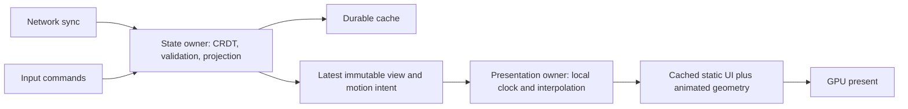

<!-- SPDX-License-Identifier: Apache-2.0 -->
# Animation and presentation ownership

Home now launches **Motion Lab** (orbiting Circle primitives) and **3D Lab** (rotating perspective tetrahedra). Both use the same Rust presentation implementation, primitive compositor and responder chain on browser Wasm/WebGL and native GLES2 (owned direct KMS or SDL/Wayland recovery). Routes are `#/animation` and `#/3d`.

## State boundary

The collaborative document contains one optional, versioned **binary FlexBuffers motion intent**: `playing`, `speed` (0.25–4), and `count` (1–64). An absent value supplies the compatible defaults: playing, 1x, 12 objects. It is an atomic CRDT byte register; concurrent edits to different settings can select one entire intent. It is not a per-property merge policy. Malformed intents are rejected on load and remote publication, retaining the old document/view.

Every presentation owner holds its own monotonic clock, phase, eased playback speed, frame samples and GPU resources. Animation advances without writing any CRDT changes. A publication replaces intent without resetting phase. Play/pause approaches its target smoothly; frames are never serialized. Independent devices need not have the same phase. Shared synchronized timelines, keyframes and physics reconciliation are later work.



On the native hosts, input events, GPU access and animation stay on the main thread. A state worker owns the app Replica and Shell, compiles static geometry and saves files. A separate network worker handles the existing incremental protocol. The renderer receives a bounded one-slot view channel; the state worker retains at most one newer pending view and replaces it when necessary. A slow renderer does not stop state processing. Input commands use a bounded 128-entry queue with explicit failure rather than silent loss. A presented-view acknowledgement lets the worker write release readiness **after** an actual frame. There is no CRDT merge, document save/fsync or readiness-file write in the frame loop.

The browser's module worker owns its Replica, Shell, WebSocket and IndexedDB cache. The main thread holds only presentation state, GPU buffers, accessibility metadata and bounded input forwarding. One view can be in flight and one latest view pending; acknowledgements prevent an unlimited queue. Pointer moves are coalesced. Worker-owned input timing avoids mixing worker and window clock origins. Existing session cache bytes are migrated as a startup fallback. Durable-cache failure keeps the running tab usable and pauses automatic code reload. Code reload preserves the local route and durable CRDT history; demo phase and local typed text restart.

Static UI geometry is compiled only on scene changes. The native hosts cache UI and telemetry separately on the GPU. The SDL recovery host copies conservative foreground regions and clears the solid stage; the owned GLES2 host retains packed geometry buffers. Opaque dynamic primitives disable blending and closed tetrahedra omit hidden faces. Animated geometry stays separate. Browser static/HUD buffers are uploaded only when changed. Existing uniform viewport/input transforms and local navigation remain in the core.

## The 3D boundary

The bounded 3D experiment transforms the four vertices of each regular tetrahedron in Rust, applies perspective, culls hidden faces and painter-sorts its four triangular faces. Each object has its own rotation phase and angular rates. Cells do not intersect. Projected faces become validated, clipped `Triangles` primitives; the same GPU triangle rasterizers fill them on both hosts. This is real three-dimensional rotation/projection, but **not** a general depth-buffered GPU scene renderer. There are no arbitrary meshes, interpenetrating objects, lighting shaders, GPU transforms or portable 3D module ABI yet. The current FlexBuffers screen asset composes controls; animated triangle payloads are local presentation output.

The shared motion intent and routes are unchanged by the tetrahedron theme. Earlier cube measurements remain historical results; compare performance only within the same geometry/release.

## Reproducing load

The final button cycles `CRDT LOAD 0Hz` → `10Hz` → `30Hz` → `STALL 250ms` → off. This setting is per device. Two isolated core Replicas perform real mutation, incremental sync encoding/receive, validation and immutable projection. Successful changes publish their revision counters through the bounded host handoff. History is reset after 120 changes. These replicas never enter the user's room or durable history. Requested rate is a ceiling, not a claim about achieved throughput.

The stall mode adds a 250 ms pause about once per second in the native state worker. In the browser it deliberately consumes 250 ms in that worker. Rendering continues from the last published view. It does not guarantee that input commands or new app intent become visible during the pause.

The HUD reports host frame-start cadence and count of intervals over 25 ms. Native `--report FILE` records FPS, interval p50/p95/p99, composition/submission and present-call timings, and actual load counters. Up to 3,600 frame intervals are retained. Long foreground hitches count; a browser visibility change explicitly suspends the clock to exclude time spent hidden. These are **not display scanout or photon-latency measurements**.

For isolated native measurements (no `--state` or `--sync`):

```sh
cargo build -p otrios-dashboard --features native --bin dashboard-native --release --locked
# On the frame, using its existing Wayland and private SDL library environment:
dashboard-native --fullscreen --screen 3d --objects 64 --load-hz 30 \
  --worker-stall-ms 250 --seconds 20 --report result.json
```

`--objects` is accepted only without `--sync`/`--state`, preventing benchmark overrides from editing a live room. `--capture FILE --capture-after 80` captures a running frame. `scripts/benchmark-dashboard-frame.py --output DIRECTORY` runs five 20-second native scenarios on the frame, temporarily stops the dashboard service, and restores it in `finally`. It uses the existing signed cached executable and leaves kernel, display mode, compositor and calibration unchanged.

`dashboard-load ws://DISPOSABLE_ROOM/stream HZ SECONDS` supplies bounded real **network intent changes**, rather than the isolated local workload. Build with the native feature. Use a separate empty server on loopback or a private VPN; never aim it at a room whose history you want to retain. The supplied results distinguish local load from network publication tests.

## Acceptance and next work

See [measured results](experiments/animation-validation.md). The initial goal is proven ownership separation and reproducible frame/load evidence. The later owned GLES2 host reaches the panel's approximately 56.6 Hz refresh with no missed vblanks in the bounded 12-tetrahedron trial. The 64-tetrahedron loaded trial still misses two vblanks; this does not establish universal refresh lock. See the [signed tetrahedron measurements](experiments/direct-display-validation.md#signed-tetrahedron-release).

Before a general animation API, add retained render-resource updates by component, a GPU transform/depth backend that supports this GLES2 hardware, actual compositor presentation feedback, and explicit shared timeline semantics. Keep hardware/driver tuning separate from this userspace experiment.

The subsequent [direct KMS experiment](DIRECT_DISPLAY.md) removes Weston and improves the measured cube cases to roughly 54 presented FPS. It still misses some panel refreshes; see [the direct results](experiments/direct-display-validation.md) and accepted [explicit EGL/GLES2 backend](rfcs/0001-direct-linux-gles2.md).

The SDL-free host retains static/HUD GPU buffers, reads evdev directly and prepares telemetry geometry on a bounded presentation worker. [The full renderer comparison](experiments/direct-display-validation.md#owned-drmeglgles2-backend) records the earlier cube geometry in both true RGB565 and 32-bit scanout; those measurements are not relabelled as tetrahedron results.
