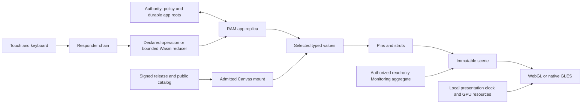

<!-- SPDX-License-Identifier: Apache-2.0 -->
# Modern app pattern and retirement map

This describes the implemented app cutover build. Deployment and physical frame
acceptance are recorded separately; source changes alone do not prove that a
running device has crossed the boundary.

## One app runtime

```text
Canvas(uiRef, stateRef)
```

Home, Component Playground, Layout Lab, Input Lab, Animation Lab, 3D Lab and
Monitoring each own an app package under `apps/<id>/`. The launcher carries
references rather than importing sibling state or behavior. UI descriptions
contain primitives, component layout, typed field selectors, responders,
navigation and optional bounded Wasm behavior. The same Canvas client mounts
those descriptions on native GLES and browser WebGL.

An app owns its schema and dependencies. Reusable controls use local component
coordinates with pins, springs and struts. Named source declarations compile to
FlexBuffers; generated control/node/selector indices are activation-scoped wire
identities, not durable app data or priorities. Repeated bindings share a
selector, so a slider and its percentage label read the same field.



The authority admits UI/State pairs from a catalog, validates operations against
its own schema, persists changed app documents, then acknowledges them. A client
holds its document, unacknowledged changes, editor focus, keyboard, captures and
presentation resources in RAM. Disconnection preserves pending RAM edits; it
does not create a client document checkpoint. Immutable code/blob caches retain
the existing bounded budgets (about 512 MiB web and 2 GiB native). Touch trails
use a separate ephemeral channel and fade without durable history.

## Admission and ownership

The publisher signs one immutable release containing the public runtime, font
resources and `apps/catalog.flex`. The catalog binds app identities and entry
references to UI hashes; an admitted UI binds its behavior hash and permitted
writes. App manifest dependency strings describe requirements, not grants.

UI/code package bytes live under the release's signed `authority/apps/` tree.
They are excluded from the public module replica and HTTP asset allowlists.
The authority checks Monitoring permission before sending its UI, executable
imports or state. An anonymous visitor may see its catalog entry and lock without
receiving its package. Public visitors and the frame use the same intended public
State roots. The trusted native listener retains unattended private access;
browser grants come from the existing server session cookie. Authentication is
never a CRDT field.

The public browser transport is `/session`; its stable opening hello negotiates
state compatibility before the channel-1 Mounted/AcceptMount/Sync stream starts.
Release/upgrade control remains available independently of state recovery, and
channel 2 carries ephemeral ink on that same socket. The old `/apps/stream` and
`/demo/ink` routes are retired. Session revocation invalidates private
mounts. The browser drops their scene, controls and private working state rather
than retaining a hidden private view. Sign-in reconnects the transport so its
upgrade carries the new HttpOnly cookie. The browser verifies the catalog against
the immutable release manifest; publisher-signature verification remains in the
existing module replica and native supervisor trust chain.

The cutover starts fresh app documents, as authorized by the user. It does not
merge the former global dashboard room into the new roots or run two writable
owners. The former persisted state remains a recovery artifact, not an active
mirror.

## Typed data and presentation

The UI/state contract is `otrios-canvas-v2`. It supports bounded numeric, text,
boolean, color and series values with fixed field types and per-field write
policy. The authority validates losing operations as well as selected values.
Input Lab's text fields are shared atomic text registers. Concurrent edits
converge by register semantics; this is not per-character collaborative editing.
Caret, selection, focus, keyboard repeat and editing buffers stay local.

Animation and 3D publish app-owned intent. Their phase, timing, interpolation,
mesh generation, HUD and retained GPU resources remain on the presentation owner.
The stress control runs a real isolated CRDT workload in RAM; it is not a stream
of synthetic writes into durable app state. It can stall the state worker while
the presentation clock continues independently.

Monitoring uses a private, read-only, replaceable FlexBuffers Layout aggregate.
Its app owns navigation/header composition; the authority supplies the current
weekly chart projection with gaps preserved. Feed replacement does not append
metric samples or binary layouts to durable CRDT history. This is the current
aggregate-view contract, not a general query or analytics engine.

A Canvas retains an immutable resolved scene until selected presentation inputs
change. Unselected state changes and acknowledgements do not rebuild it. Sync
uses coherent Merkle coverage compiled from the admitted UI and that writer's
receipt, within the app State scope. Durable state stays on the authority and
pending intents stay in one RAM queue ([foundation rollout](experiments/canvas-foundation.md)).
General collection/item/cursor selectors from RFC 0003 remain unimplemented.

Current bounds include 64 schema fields, 4 KiB text values, 2,016 series points
and 512 KiB Canvas messages/artifacts. The durable adapter bounds writer receipts
to 1,024 per app with a 24-hour resume window, rotates its journal at 4 MiB
and fails explicitly on exhaustion. Unlimited documents, general history GC
and arbitrary schema migration are not supplied by this cutover. A schema change needs an explicit compatible migration or new
State reference.

## Fonts and graphics

Fonts are separate compressed immutable resources, loaded and verified once.
An explicit retained font supplies metrics and GPU curve/band data; no embedded
alphabet or ambient font singleton is required. Current bootstrap font references
remain generated filename/hash metadata rather than a general OS resource graph.
Baseline/line-box metrics are separate from glyph ink and ancestor clipping.
Full Unicode shaping remains outside this implementation.

The shared Slug path generates glyph quads and a disposable 4 MiB GPU coverage
atlas. Premultiplied white coverage can be reused across tints and exact physical
sizes/subpixel phases. Browser backing buffers follow CSS size and device pixel
ratio within texture bounds. Public mesh colors remain straight authored colors;
rendering converts them to premultiplied values and uses premultiplied blending.

The default path composites directly in the ordinary framebuffer. An opt-in
linear-light reference path retains the fullscreen conversion for comparisons;
premultiplication alone does not make ordinary sRGB blending gamma-correct.
Code/blob caches, glyph coverage and framebuffer allocations are separate budgets.
See [RFC 0006](rfcs/0006-font-resources-and-text-presentation.md).

## Retirement and retained building blocks

| Mechanism | Cutover disposition |
| --- | --- |
| Fixed dashboard Shell/screen branches and compiled demo UI | Replaced in production by the admitted app catalog and Canvas mounts. New app UI belongs in `apps/`, not another host screen branch. |
| Global demo room and ambient DashboardView bindings | Replaced by app-owned typed roots; app layouts resolve explicit slots. No durable legacy-room bridge is introduced. |
| Dashboard/MotionPresenter browser adapters | Replaced by CanvasApp and generic CanvasPresentation. The modern Wasm host excludes the old Dashboard exports. |
| Separate trusted prototype package loader | Removed; development and production are thin entries into the same authority. Production admits packages from signed releases. |
| Per-frame scene reconstruction | Replaced by selected-value scene caching and retained GPU resources. |
| SDL/Wayland app path | Removed from the app build and host dependencies; direct GLES is the supported frame path. Old signed recovery artifacts require their compatible service/protocol, not an implied universal rollback. |
| Five-field UI schema | Replaced by typed v2 fields. The bounded Wasm reducer ABI remains separately versioned v1. |

Keep one implementation of scene validation, responder routing, keyboard editing,
pins/struts, rendering, direct display, artifact caching, signing and recovery.
Their historical `dashboard/` directory does not make the generic code obsolete.
Unrelated earlier OS snapshot/IPC experiments are separate milestones rather
than compatibility requirements for app navigation.

Shared authoring lives in `tools/canvas/authoring.rs`; stable builders can move to
the SDK without copying LGPL runtime implementation into permissive packages.
Coherent covered Merkle replication is deployed on both hosts. The generic
library supports multiple authorized paths, and Canvas derives its coverage from
admitted UI dependencies. General collection selectors remain in progress. General OS loading,
arbitrary capability imports and cross-app transactions remain outside this
milestone. Follow the [foundation completion ledger](rfcs/0010-runtime-foundation.md)
for current source, acceptance and deployment gates.

## Rounded corners

`Primitive::Superellipse` uses four local superelliptic quarter arcs joined by
straight sides. The usual exponent is 4; exponent 2 gives circular corners.
Each arc uses `x = cx + r sign(cos θ) |cos θ|^(2/n)` and the matching sine
expression for y, currently sampled at twelve segments per quarter. Hit testing
uses the corresponding equation. This is not one global Lamé oval or a claim of
exact equivalence to Apple's continuous corners. Radius is bounded by half the
shorter side; zero produces a rectangle.
