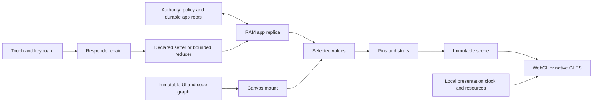

<!-- SPDX-License-Identifier: Apache-2.0 -->
# Modern app pattern and retirement map

This is the implementation direction, with a removal plan for the experiments
that preceded it. The live dashboard and the isolated Canvas prototype are still
different hosts. A new app should follow this pattern rather than add another
branch to the dashboard shell. Breaking prototype compatibility is acceptable;
authority policy and ownership of durable data must remain explicit.

## The unit of composition

```text
Canvas(uiRef, stateRef)
```

An app owns its UI graph, state schema, behavior and immutable dependencies in
`apps/<app>/`. The launcher passes references, not sibling app internals. The
same UI can mount against different compatible State roots. Components define
local coordinates, pins, springs and struts; instances supply frames, inputs and
bindings. Named source declarations compile into typed binary contracts.

UI is data: Canvas, Text, Superellipse, Circle and geometry, with a responder
tree and selectors. Repeated bindings share a selector; a slider and percentage
label can read the same field. Stable schema IDs identify data. Generated node,
control and navigation indices are transport identities scoped to an activation,
not durable user data or paint priorities.

Behavior is a bounded Wasm reducer loaded through the UI's dependency graph. It
receives declared inputs and emits typed commands; it does not own a second
document, bypass authority policy, acquire ambient capabilities or run the
presentation loop. Declarative setters need no guest. WAT is a transparent test
fixture, not a required future app authoring language.



The authority validates scope, schema and permitted operations, merges conflicts,
persists accepted state, then acknowledges it. Clients retain documents and
pending interaction in RAM. Only immutable code and blobs enter bounded caches
(the deployed defaults are about 512 MiB web and 2 GiB native). Touch trails and
presence are ephemeral streams. Navigation, focus, capture, animation phase,
frame timing and GPU buffers are local presentation state.

Signed graph admission and server-issued capabilities must protect private UI,
code and state **before their bytes are sent**. The isolated Canvas server
currently trusts a local package registry and checks hashes; it is not yet that
production admission service. Hashes identify bytes; they do not grant access.

## What exists today

Home, Component Playground and Layout Lab have independent prototype UI/State
roots. Playground loads a Wasm reducer. Other app folders inventory their legacy
adapters; they are not independent executable app packages yet.

The Canvas runtime projects declared fields and retains one immutable resolved
scene until a selected value changes. Acknowledgements, history changes and
unselected field edits do not rebuild that scene. This is presentation
invalidation, **not Merkle subtree replication**: sync still transfers the
app's document. The current state ABI is five normalized register fields, not a
general collection or object schema.

[RFC 0002](rfcs/0002-incremental-crdt-hierarchy.md) and the
[selector RFC](rfcs/0003-module-roots-and-state-selectors.md) describe
the next hierarchy/collection work. They must become one shared state store,
not separate CRDT implementations in each app. See the RFC directory for the
current proposals; their existence does not imply runtime completion.

The layout engine supports local component coordinates and parent resizing.
Reusable source components compile into binary trees. External template loading,
intrinsic text measurement, sibling constraints and persistent logical keys for
collaborative UI-tree editing remain separate work. The default surface is still
1280 × 800. A general constraint solver is unnecessary for the present controls.

## Fonts and presentation resources

Fonts follow the immutable resource path, alongside code and blobs. Entry code
initializes generic resource and presentation services; a trusted root app graph
should supply font references. The current bootstrap still uses small generated
Roboto filename/hash references, while actual quadratic font bytes travel as a
separate compressed resource through the bounded cache. That transition has not
completed the signed Home graph or legacy Shell migration.

`Font::from_zstd` verifies admitted identity and bounded decoding once. An explicit
retained font supplies line metrics, glyph advances/ink bounds and a prepared GPU
curve/band atlas to both hosts. Baseline and line-box metrics are separate from
glyph ink: accents, descenders and negative bearings must survive text frames;
ancestor canvases own clipping. There is no embedded alphabet or ambient global
font singleton.

The shared Slug shader path emits glyph quads. A disposable 4 MiB GPU coverage
cache reuses exact glyph/size/phase/transform results across tints; it does not
change app state or persist touch/animation data. Coverage stays linear in a premultiplied-white atlas; text tint remains reusable.
The default atlas path renders directly to the ordinary
framebuffer for speed; exact linear-light compositing is a separate opt-in
reference path because its full-screen conversion was costly on the frame. Cache capacity is separate from the code/blob cache and framebuffer
allocations. Full Unicode shaping and generic app bootstrap remain unfinished;
measured graphics capabilities are not an FPS acceptance claim.

[RFC 0006](rfcs/0006-font-resources-and-text-presentation.md) defines admission,
metrics, coverage/cache/color contracts and the current limits. The
[font resource guide](../assets/fonts/roboto/README.md) records source hashes,
licensing, packet layout and deterministic regeneration.

## Simplifications made in this pass

- App layouts resolve against explicit local slots. They no longer construct a
  fake empty dashboard view; global dashboard bindings and legacy responder
  domains are rejected at app activation.
- Scene resolution is cached per selected-value projection. Text/control getters
  share that scene instead of repeatedly rebuilding it.
- Navigation and behavior retain distinct action domains. The fallback from an
  unknown navigation action into a behavior event, the unused outgoing queue and
  cancellation of a freshly created router were removed.
- `otrios-web-host` exports only Canvas. It does not export the old Dashboard or
  MotionPresenter APIs. The legacy web host remains available for the live demos.

These are boundary reductions, not new compatibility layers. The separate
browser crate can shrink further once the generic UI runtime no longer compiles
through the dashboard module tree.

## Retirement map

| Code or mechanism | Disposition | Concrete removal or replacement gate |
| --- | --- | --- |
| `core/dashboard/shell.rs`, screen branches, `shell_seed.rs`, generated shell assets | Retire the app-specific shell | Home mounts admitted apps on web/native; each app owns its inputs, state and navigation. Do not add new demo branches here. |
| `Replica`, `DashboardView`, Label/Switch/Graph snapshots, shared demo room | Replace with app-root state | Explicit truth-state cutover and persisted migration; one writable owner. Preserve an offline recovery snapshot, not a permanent mirrored authority. |
| Dashboard bindings and responders in layout contracts | Quarantine, then delete | App activation rejects them now. Remove variants when no admitted UI or recovery asset consumes them. |
| `canvas/state.rs` alongside the old replica | Temporary competing models | Converge on one typed state store after the app-root migration; measure the RFC 0002 representation before expanding either model. |
| Layout v1 decoder and fixture generator | Stop authoring new v1 UI | Repack admitted modules to v2, exercise reload/recovery, then delete v1 decoding. No indefinite format fallback. |
| Legacy Dashboard/MotionPresenter Wasm exports | Removed from the modern bundle | Delete their old host when the deployed web apps use the Canvas host. |
| Separate prototype server and production dashboard service | Keep the prototype as a test harness | Add app admission/subscriptions to the production authority; reuse its auth, durable storage and ephemeral streams. Avoid building a second full auth service. |
| SDL/Wayland fallback and signed `dashboard-sdl` artifacts | Quarantined; the SDL renderer cannot draw Slug glyph quads | New Slug releases publish direct GLES and browser hosts only. Retain the prior validated signed release for rollback; remove old recovery paths after direct-display crash/rollback acceptance and coordinated publisher/agent/manifest updates. |
| Five-register ABI, hand-listed pack registry, derived default refs | Prototype scaffolding | Versioned typed commands/schema plus an admitted app catalog; remove scaffolding in that cutover. |
| Per-scalar host getters that traverse scene metadata | Consolidate | One coherent frame-view payload if profiling shows traversal matters; the expensive repeated scene construction is already removed. |
| Failed mount leaves the old view read-only until reconnect | Replace lifecycle behavior | Stage and validate a candidate UI/state/guest together, then publish atomically; exercise rejected update and rollback without losing the current input session. |

Keep and extract the generic implementations: scene validation, input routing,
keyboard editing, pins/struts, mesh generation, direct display, code/blob cache,
signing and recovery. Their current `dashboard/` location does not make them dead
code. Move them when their ownership is clear; avoid cloned implementations or
permanent forwarding modules merely to rename directories.

Shared authoring currently lives in `tools/canvas/authoring.rs`. Move stable
builders into the SDK once their binary contract is settled. The SDK must not
absorb copied LGPL runtime implementation.

## Cutover sequence

1. Establish the app-only host and explicit projection boundary (this pass).
2. Implement signed app-graph admission, private capability checks and staged
   mount/reload/rollback in the production authority and both hosts.
3. Move Component Playground to that path, including its ephemeral trail
   capability. Keep public visitors and the frame on the same intended State root.
4. Migrate Input Lab, animation and 3D to app-owned intent. Keep animation phase,
   mesh/GPU resources and clocks local; do not force a per-frame interpreted guest
   loop. Migrate Monitoring behind its private admission gate. Delete the old
   shell and global room rather than maintaining both app models.
5. Remove v1 assets and the SDL recovery path once their installed consumers have
   crossed their stated gates. Generalize state/selectors through the measured
   Merkle/CRDT design, not through additional demo-specific stores.

## Rounded corners

Yes: `Primitive::Superellipse` uses four superelliptic quarter arcs joined by
straight sides. The usual exponent is 4; exponent 2 gives circular corners.
The local arc is sampled using
`x = cx + r sign(cos θ) |cos θ|^(2/n)` and the matching sine expression for y.
There are currently twelve segments per quarter, emitted as triangles. Hit
testing uses the corresponding superellipse equation.

This is a rounded rectangle with superellipse corners, not one global Lamé oval
and not a claim of exact equivalence to Apple's continuous-corner geometry.
Radius is bounded by half the shorter side; zero radius produces a rectangle.
