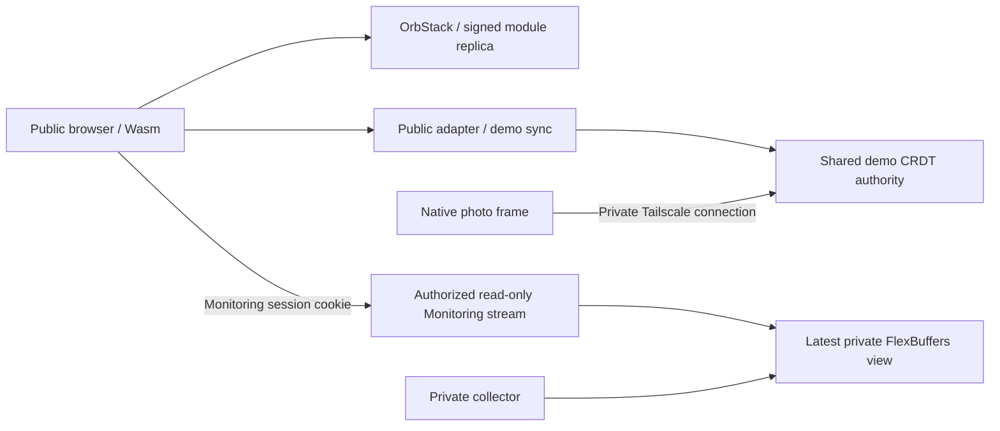

<!-- SPDX-License-Identifier: Apache-2.0 -->
# Public demos and private Monitoring

`https://otrios.otri.ca` opens Home without sign-in. Live Controls, Input Lab, Motion Lab and 3D Lab are public. Demo app state is the **same Automerge document used by the photo frame**: public controls can change its shared intent. Navigation, text entry, stress-load controls and animation phase remain local to each host. Monitoring requires a separate sign-in and subscription.

## Authorization boundary

The Rust authority has two listeners. The existing loopback `127.0.0.1:8876` listener retains the trusted native/Tailscale protocol and administrative APIs. A second loopback listener, `--public-bind 127.0.0.1:8878`, exposes a fixed browser API allowlist. Both share the same app state and process. Caddy proxies only to the public adapter; it never forwards a public request to the trusted listener.

| Public route | Policy |
| --- | --- |
| `/`, `/release`, `/releases/ID/...` | Public immutable signed code; no live Monitoring values in the bundle |
| `/demo/stream` and legacy `/stream` | Public demo CRDT and release notices; **no Monitoring frames** |
| `/health` | Public status and code release only |
| `/auth/session` | GET session status; POST sign-in; DELETE sign-out |
| `/monitoring/presentation`, `/monitoring/stream` | Valid Monitoring session required; read-only private view |
| `/layout`, `/presentation`, `/sync`, other paths | Not exposed; public requests return 404 even after sign-in |

Anonymous CRDT messages are validated operation by operation, including losing conflicts. Only the defined demo control fields can change; layout, schema, title and arbitrary fields cannot be written through public sync. Private Monitoring bytes remain outside Automerge history. A whole shared document is public history: do not insert private data into it and expect a hidden screen to protect that data. This is a bounded demo authorization policy, not the general OTriOS capability runtime.

The public connection requires an exact allowed browser Origin and is bounded separately from trusted native connections. Public code never grants itself access by writing an `authenticated` value into CRDT state. The locked launcher/scene is presentation only; the server decides whether private bytes can be delivered.

## Monitoring sessions

Selecting Monitoring opens sign-in. The existing username and seven-word password remain valid. The server reads a private mode-600 JSON file supplied with `--auth-file`, containing `username` and `password_hash`; the hash is the existing Argon2id PHC string. Credentials, hash files and tunnel secrets are excluded from Git and module images. The pinned RustCrypto Argon2 dependency verifies that existing hash; random tokens and SHA-256 reuse existing dependency versions.

Successful sign-in rotates a cryptographically random 256-bit opaque session. Only its digest is retained server-side; the browser receives a host-only `Secure; HttpOnly; SameSite=Strict; Path=/` cookie. The session expires after eight hours by default. Sessions are memory-only, so restarting the authority signs browser sessions out. POST/DELETE require exact Origin, a custom request header and JSON; passwords/tokens never enter URLs, CRDT state, browser storage or logs. Login verification has one worker slot and a global limit of 20 attempts/minute; sessions are capped at 128.

The private subscription is opened only when Monitoring is visible. Leaving the app drops that subscription and view from application memory. Logout clears the local view immediately, revokes the server session and closes its streams; an expiry check runs once a second. Unauthorized direct fetches and WebSocket upgrades return 401. New Monitoring views are not persisted in IndexedDB or HTTP caches. The browser retires legacy document databases and session-storage values, starts with a fresh in-memory replica, and resubscribes to the authority. Only immutable public artifacts enter the bounded cache described in [client storage](CLIENT_STORAGE.md). Data already delivered to an authorized user cannot be recalled from copies they made.

The browser uses standard password fields for password-manager and accessible credential entry, while the launcher, locked screen and Monitoring view remain shared scene primitives. Native frames keep the trusted unattended Tailscale subscription and do not require an interactive browser session.

## Module distribution and hosting

The module host has its own read-only immutable code store, bootstrap and atomic release pointer. It serves signed Wasm/UI code without asking the state authority for files. An offline state upstream does not prevent code delivery. The Mac and OrbStack still need to remain online; process separation on one Mac is not off-machine availability.

`publish-dashboard-module.py` verifies the Ed25519 signature, manifest hash, target/schema, allowed paths, sizes and every asset digest before transfer. It verifies volume checksums and advances the code pointer only after the complete bundle exists. With `module_volume` configured, delivery precedes the authority's code announcement. Browser release readiness preserves the current runtime/state session while a replica lags.

`tools/dashboard/module-host/` contains the pinned Caddy image and Compose profile. The container is non-root, has no capabilities, a read-only root/module volume and bounded resources. Its port 8877 binds to Mac loopback. A dedicated outbound Cloudflare Tunnel routes only `otrios.otri.ca` there; existing tunnels and private Tailscale Serve remain. HTTPS terminates at Cloudflare; tunnel transport is encrypted. Caddy strips cached Basic Authorization headers and forwards the session cookie to the browser adapter. It has no password hash mount.

## Deployment and verification

Private runtime files live under `~/Library/Application Support/OTriOSDashboard/`. Preserve the state document, current Monitoring presentation, publisher key/cache, existing frame recovery and Tailscale route. Add the private auth JSON and public adapter arguments to the existing server service, verify the adapter, publish the new browser runtime, then switch only the module container's proxy configuration. Retain the former server/container files for rollback. Never open the trusted administrative listener through the public proxy.

Run `bash scripts/check.sh`, the Node release/session tests, and `scripts/test-dashboard-module-host.py --url https://otrios.otri.ca --credentials PRIVATE_LOGIN_FILE`. Credentials are read privately and never printed or passed as process arguments. The live checks cover anonymous exact signed web bytes, raw Wasm, denied admin paths, private-cookie checks, Origin rejection, public stream isolation, login/logout and private-stream revocation. `--connect-ip` retains normal TLS hostname verification when diagnosing stale DNS. An isolated unavailable-upstream container can exercise `--state-unavailable` without stopping the room.

To stop public access, stop only the dedicated tunnel. To rotate the password, replace the private hash configuration and restart the authority, which revokes existing sessions. No DNS, kernel, display timing or frame calibration changes are needed for this access policy.

References: [OWASP sessions](https://cheatsheetseries.owasp.org/cheatsheets/Session_Management_Cheat_Sheet.html), [OWASP WebSocket authorization](https://cheatsheetseries.owasp.org/cheatsheets/WebSocket_Security_Cheat_Sheet.html), [Caddy reverse proxy](https://caddyserver.com/docs/caddyfile/directives/reverse_proxy).
