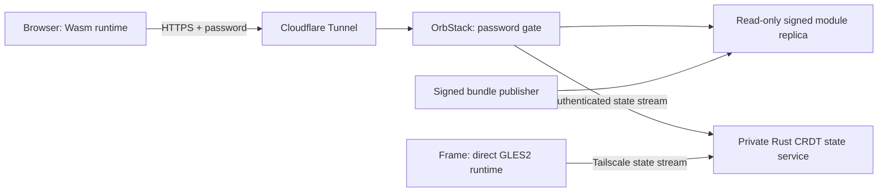

<!-- SPDX-License-Identifier: Apache-2.0 -->
# Password-protected dashboard module

`https://otrios.otri.ca` serves the signed dashboard module from an independent OrbStack container. A server-side password check runs before **every** handler: the bootstrap, release pointer, HTML/CSS/JavaScript, Wasm, manifests, state APIs and WebSocket upgrades. A client receives HTTP 401 without module payload until it supplies the approved username/password. The password is a generated seven-word EFF passphrase; only an Argon2id hash is mounted in the container. Plaintext login details stay outside Git and are never included in a module or image.



The module host has its own immutable code store, bootstrap and atomic release pointer. It serves code without asking the state service for files. When the state upstream is unavailable, authenticated clients can still load the complete Wasm/UI module; sync reconnects independently. This is process/network separation on the current Mac, not off-machine hosting availability. The Mac and OrbStack must remain awake and online.

## Deployment

`tools/dashboard/module-host/` contains a Caddy configuration, tiny bootstrap, pinned official image and Compose profile. The derived image removes Caddy's low-port file capability; the service runs as a non-root user with a read-only filesystem, no capabilities, a read-only module volume and bounded resources. Port 8877 binds to Mac loopback only. A private `auth.caddy` snippet supplies the username and Argon2id hash. A dedicated outbound tunnel forwards only `otrios.otri.ca` to this port and returns 404 for unmatched hostnames. Existing translation tunnels are separate.

The state authority remains on its existing private port. Caddy verifies credentials and **removes Authorization** before proxying `/sync`, `/stream`, `/layout`, `/presentation` and `/health`. The state service permits the exact public HTTPS Origin alongside its original Tailscale Origin and rejects other browser Origins. Frame traffic continues through Tailscale. HTTPS terminates at Cloudflare; the tunnel is encrypted and its local origin is loopback. No inbound router port is opened.

The private runtime is `~/Library/Application Support/OTriOSDashboard/module-host`. It holds the hash snippet, tunnel credential/config, Compose environment and module publication marker. The Docker volume is `otrios-dashboard-modules`. Dedicated LaunchAgents maintain module replication and the tunnel; the container uses `unless-stopped` restart behavior. Login details are a separate mode-600 user deliverable outside the repository. Do not copy that file into the container or a release.

Create a hash interactively with the pinned Caddy image's `caddy hash-password --algorithm argon2id`. The private snippet is:

```caddyfile
basic_auth argon2id {
    APPROVED_USERNAME ARGON2ID_HASH
}
```

Set `OTRIOS_MODULE_AUTH_FILE`, `OTRIOS_MODULE_UID` and `OTRIOS_MODULE_GID` in a private Compose environment file. The UID/GID must read the mode-600 snippet. Publish a verified bundle into the named volume before starting Compose. The volume is deliberately read-only in the web service; only a short-lived, network-disabled publication container receives a writable mount.

## Code/state handoff

`publish-dashboard-module.py` verifies the Ed25519 publisher signature, manifest SHA-256, target/protocol, exact allowed asset names, sizes, containment and every asset digest before transfer. It verifies transfer checksums inside the volume, preserves older immutable releases and advances the module pointer only after the full bundle exists. Failure keeps the previous verified module.

With `module_volume: "otrios-dashboard-modules"` in the private builder configuration, activation has two phases: stage/sign the bundle, copy and verify it on the module host, then advance the state authority's release pointer. A shared publication lock prevents the repair watcher from rolling back a release during that handoff. The state server cannot announce this release before its configured module replica is ready.

The browser additionally uses `release-gate.mjs`. It keeps the running runtime and CRDT session while checking its own code host's atomic release pointer. Delayed/unavailable replicas retry; a newer announcement cancels obsolete preparation. Only a ready matching release can trigger durable-state save and navigation. This supports future replicas with independent delivery delays. Module and state schema identifiers are unchanged.

## Verification and recovery

Run `scripts/test-dashboard-module-host.py --url https://otrios.otri.ca --credentials PRIVATE_LOGIN_FILE`. The credential file has `Username: ...` and `Password: ...` lines; secrets are read privately and never printed or passed as process arguments. Tests cover missing/wrong passwords for every payload, raw Wasm/HEAD/POST requests, exact signed bytes and Wasm MIME, foreign-Origin rejection and authorized WebSocket upgrades. `--connect-ip` is a diagnostic for a stale DNS cache and retains normal TLS hostname verification.

An isolated second container with an unavailable state upstream exercises `--state-unavailable` without interrupting the real room. The code bundle still loads while state requests fail. Node tests cover delayed/superseded code readiness; Python checks reject tampered assets and premature activation. Initial full public HTTPS checks and outside-tailnet unauthenticated denials passed.

To stop public access, stop only `com.otri.otrios-dashboard-tunnel` and remove the specific new DNS record. To rotate the password, replace the private hash snippet and recreate the module container; active WebSockets reconnect and must reauthenticate. Preserve the module volume, state file, Tailscale Serve and frame recovery profile. Removing public access does not require stopping the room or frame.

References: [Caddy password authentication](https://caddyserver.com/docs/caddyfile/directives/basic_auth), [WebSocket proxying](https://caddyserver.com/docs/caddyfile/directives/reverse_proxy), [Cloudflare Tunnel routing](https://developers.cloudflare.com/tunnel/concepts/routing/).
