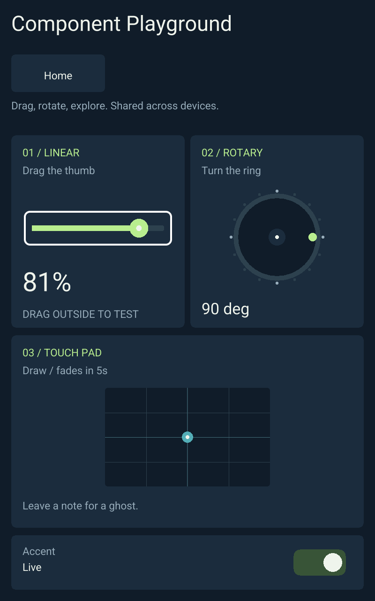
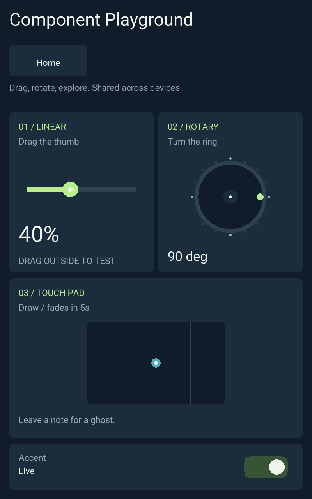

<!-- SPDX-License-Identifier: Apache-2.0 -->
# Independent app behavior validation — 2026-10-24

[RFC 0014](../rfcs/0014-app-behavior-updates.md) extends the shared app package
update path with compatible Wasm replacement. The initial runtime support is a
full release; subsequent guest edits compile only the selected app module.

## Automated checks

- `RUST_TEST_THREADS=1 bash scripts/check.sh`: formatting, strict workspace
  Clippy, 170 Rust tests and 39 Python checks pass.
- All 46 browser session/worker/cache/catalog/viewport/update/GPU tests pass,
  along with the Wasm release build, bindings and export check.
- ARM all-feature/all-target Clippy and release builds pass, including the direct
  host, authority, bootstrap and headless Canvas process probe.
- A stateful test guest proves document values survive a code update, replacement
  guest memory starts fresh, and repeating the catalog does not reset the guest.
- Rejected/trapping candidates retain the prior guest, scene and catalog. ABI,
  writable-field and simultaneous UI-contract changes are rejected.
- Partial-transfer tests reconstruct verified signed guest releases from the
  installed runtime and require the advertised behavior update capability.

## Acceptance experiment

The browser experiment keeps Playground and Home open in different orientations,
records the actual active guest hash, confirmed slider value and ownership, then
waits for a compatible guest release. The demonstration changes the linear slider
from continuous values to ten-percent steps. No UI source edit is needed.

```sh
node scripts/test-responsive-browser.mjs --url http://127.0.0.1:18877 \
  --wait-behavior-update --output target/app-behavior-browser
```

The experiment passes. The loaded guest hash changes from
`8bdbbb88a979d43eee0b01645826ed2f0e8a10d6a6f20cdaedff08626f91a12a`
to `4999a78c65f4412e1e17b6d85589c3f7bcc50ef6f5bf3fe5aeaa6998d6ed41ad`.
Playground retains its 81% value until the next input, which then produces 40%
instead of 43%. Both pages retain their time origins and WebSocket sessions;
Home retains its epoch, and Playground retains its control identities and focus.
Another client mounts the new code and receives the shared confirmed value.





## Live frame qualification

Runtime source `17b76c7` was installed as release
`ec40972ec5648f7fe9031fe8ea6eae7a19eff039390b9c359fac118cea1a41be`.
Behavior source `4ff8731` was then published independently as
`d1a3924e234aea4e0e9167c4fd9bc4efd0799a6151543ff3ab585bc041ce9a78`.
Only `behavior.wasm`, its reference in `ui.flex`, and `apps/catalog.flex` changed.
The module is 218 bytes. The complete partial transfer, including metadata and
installation helpers, was 112,640 bytes (110 KiB). The cached authoring tool ran
in 0.13 seconds with no Rust, native host or browser Wasm compilation.

The authority PID remained 11365, and the native renderer PID remained 11409.
The native Home mount retained its epoch while the unrelated Playground module
changed. A separate hash-verified ARM headless probe ran on the frame against
its actual authority; input 730 produced `level=700`, with acknowledged state
and rendered primitive geometry. The temporary test executable was removed.
This is real native process execution, separate from GPU/touch acceptance.

A later UI-only publication (`8949b18`) changed the instruction to
“Drag / 10% steps,” retaining the identical Wasm hash and both host processes.
The final release is
`87db0c3d102fd279201f8bad18d6d8af1caa9c5045cadc5e76d44fce9a1288eb`.
Repeating the behavior publish reports `UNCHANGED` and transfers nothing.
A stateful mixed-update test also verifies that the later UI-only replacement
retains the already-replaced guest's memory. Public HTTPS conformance passes
70 checks; Monitoring login and physical touch/color/performance were not tested.

[Machine-readable evidence](app-behavior-updates.json)

