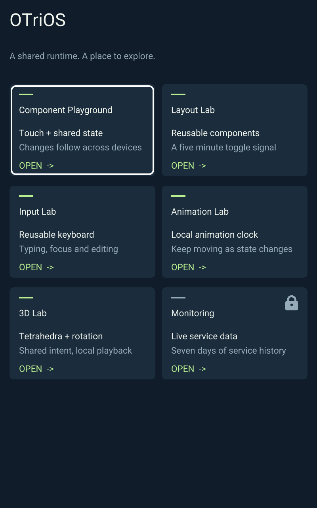
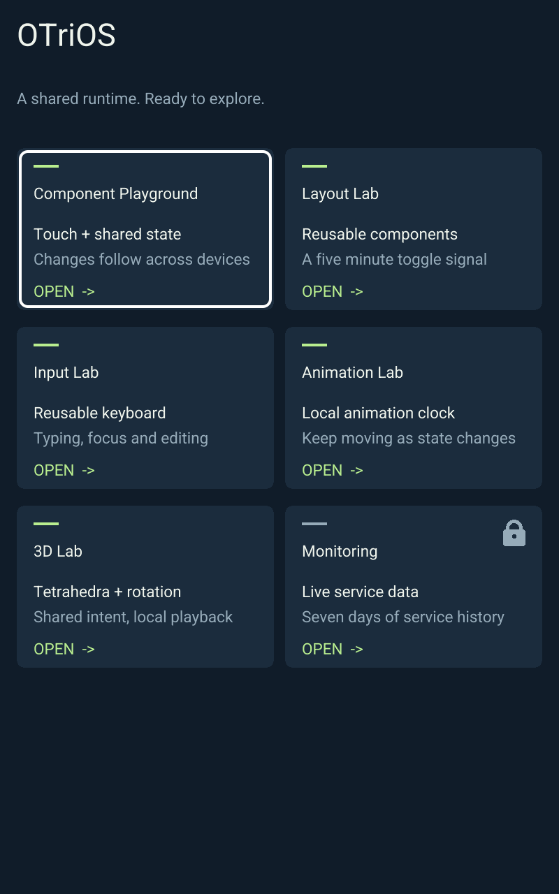

<!-- SPDX-License-Identifier: Apache-2.0 -->
# Independent app UI update validation — 2026-10-24

All seven apps use one package factory API and the same UI replacement contract.
See [RFC 0013](../rfcs/0013-app-ui-updates.md) for the signed closure, runtime reuse,
publication and activation boundaries.

## Automated validation

- `RUST_TEST_THREADS=1 bash scripts/check.sh`: passes formatting, strict workspace
  Clippy, 168 Rust tests and the Python release/direct/hosting/publishing checks.
- All browser session, worker, cache, catalog, viewport, UI update and GPU suites:
  45 JavaScript tests pass. The Wasm release build/bindings and export check pass.
- ARM all-feature/all-target workspace Clippy and release host builds pass.
- Core tests replace each of the seven apps' UI documents through the same API,
  preserve state, reject incompatible contracts, preserve the current scene on
  rejection, and make repeated admission a no-op without advancing its epoch.
- Partial transfer tests reconstruct a complete verified signed release from the
  installed baseline; missing changed assets and stale baselines are rejected.
- Repacking all apps preserves all 15 package files' bytes and timestamps.
  Repeating an unchanged UI publish reports `UNCHANGED` and skips deployment.

## Real browser experiment

A disposable local authority serves the same browser runtime as the frame build.
Home remains open in portrait while Playground remains open in landscape, with
its linear slider confirmed above 75 percent. The publisher changes only Home's
introduction to “A shared runtime. Ready to explore.”

`node scripts/test-responsive-browser.mjs --url http://127.0.0.1:18877 --wait-home-update --output target/app-ui-browser`
passes. Both pages retain `performance.timeOrigin`, their original paths and
WebSocket sessions. Home retains compatible semantic keyboard focus. Playground
retains its mount epoch and confirmed slider value. Later navigation opens the
new Home document through the updated catalog. A window marker also survives,
proving the existing page remained loaded.

The browser retains its verified manifest in RAM; unit tests also check updates
when the previous manifest URL has already been pruned. This fixture uses its
own signing identity and does not establish physical device acceptance.

[Machine-readable results](app-ui-updates.json)

## Deployment

Live frame qualification is recorded after the initial runtime installation and
subsequent UI-data-only publication. No new rollback or external backup tooling
is introduced.
