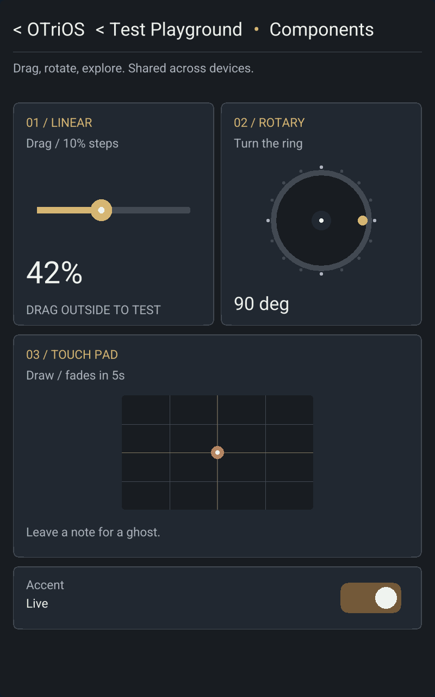
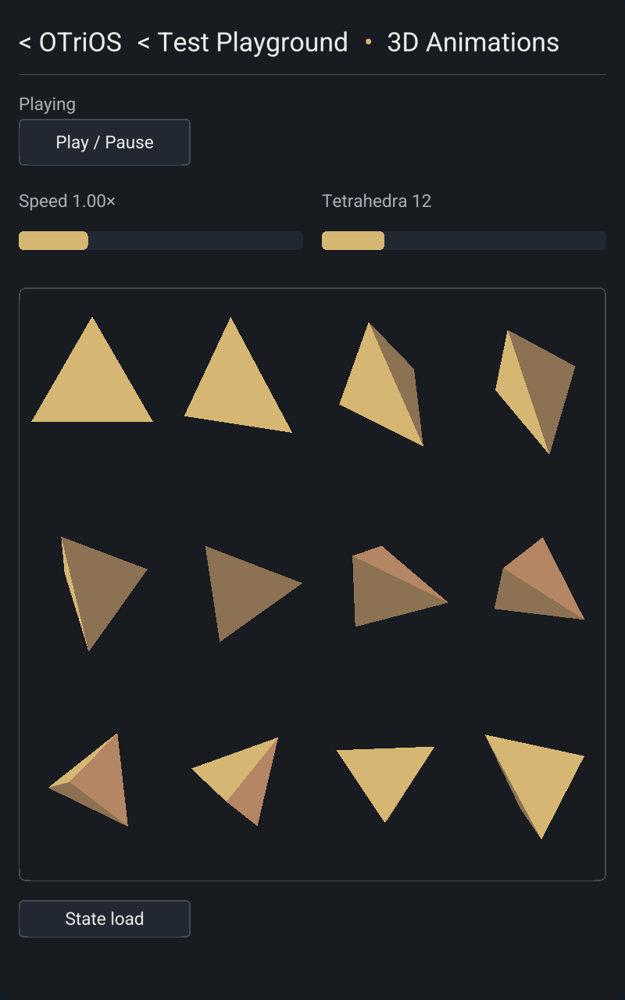
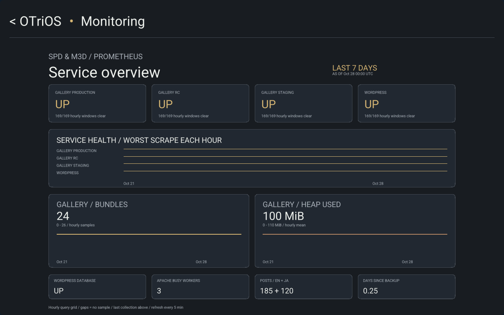

<!-- SPDX-License-Identifier: Apache-2.0 -->
# Shared brass app theme — 2026-10-28

All shipped apps now share The Brass Relay's charcoal surfaces, brass/copper
accents, fine outlines and header divider. Clickable ancestors replace separate
Home/Back buttons: `< OTriOS • Test Playground` and
`< OTriOS < Test Playground • Layouts`, for example. Ancestors are authored app
identity links, resolved through the admitted catalog.

All seven Test Playground demos support landscape and portrait. The two motion
apps share a reflowing control component and an authored flexible stage; native
and browser hosts receive the same logical stage bounds. Text Input's keyboard
fits portrait width while retaining key height and the existing press feedback.
Monitoring keeps its landscape layout and private admission, with its aggregate
uniformly fitted beneath the header.

Shared color tokens live in the Apache-licensed interfaces crate; runtime-owned
presentations consume them from LGPL core. UI v6 adds the optional motion-stage
reference. State protocol v8 and the opening release-control v1 envelope remain
unchanged; this work does not change CRDT state encoding or the input thread model.

## Qualification

[Machine-readable results](data/brass-app-theme-2026-10-28/qualification.json)
record release identities, the 19 native trials, browser matrix and keyboard
metrics. The commands below used Rust 1.90.0 and locked dependencies. No dependency
or Cargo.lock changes were required.

- `bash scripts/check.sh` passed, including 61 Canvas tests, touch replay,
  process/socket tests, workspace Clippy and formatting.
- `cargo test -p otrios-dashboard --features direct --bin dashboard-direct --locked --offline`
  passed all 11 input/transport/threading tests.
- ARMv7 `cargo clippy -p otrios-dashboard --all-targets --features direct,server,canvas --target armv7-unknown-linux-gnueabihf --locked --offline -- -D warnings`
  passed. Release builds of all dashboard binaries and `keyboard_latency_probe`
  passed with the same target and features.
- `bash scripts/build-dashboard-web.sh` passed. The Node suite passed 79 tests.
- Real Chrome/WebGL `scripts/test-responsive-browser.mjs` passed `--brass-theme`,
  `--brass-monitoring`, `--navigation` and `--touch-replay` against a disposable
  loopback authority. `scripts/test-chat-browser.mjs` passed chat, native DOM
  editing, IME, reflow and context recovery acceptance there.
- The brass matrix checks all seven demos in both orientations, control bounds,
  ancestor destinations, text entry, stable control IDs through rotation, motion
  stage bounds and actual breadcrumb pixels in the saved PNGs.
- Physical Frame GLES2/RGB565 trials admitted Home, Test Playground and all seven
  demos in both orientations, plus Monitoring in landscape. All 19 reported
  confirmed state, a ready stream and zero pending commands. The display controller
  restored the existing kiosk and console mode on exit.
- Separate on-frame keyboard probes retained all 52 characters and 104 edges at
  8.33 keys/s, with pressed-key pixels observed in both Brass Relay landscape and
  Text Input portrait. Release-to-present p95 was 65.7 ms and 57.5 ms respectively.
  These are synthetic taps through the real editor/composer/GLES2 and kernel page
  flips, not human finger measurements. The short screen trials are rendering and
  admission checks, not sustained performance benchmarks.

The native qualification release and final release have identical native,
Wasm, catalog and authority app assets. Their only payload difference is a
formatting cleanup in `web/app.js` and its gzip; the final browser matrix and touch
replay ran against the final signed release.

## Captures

These captures come from the physical Frame with isolated fresh app state.
Monitoring uses a synthetic fixture; no production telemetry is included.

## Release and rollback

Final signed release:
`be7ddb85799dd1b42cf92bef03957be993be2bff4c6eec150b9f9d55e80a582c`.

Native binary SHA-256:
`75962966aafe51da723ff1c6502437346d3d7b8b65339d132927403ef37af455`.

Before deployment, a stopped, hash-verified snapshot preserved the current app
journals, signed release store, presentation and installed binaries at
`/var/lib/otrios-authority/rollback/2026-10-28-brass-theme`. The previously active
release was `35b71e2488fb2125d1b27bd58861733e6566e70bc702cbaf237debdcbd99efb2`.
The accepted touch calibration was unchanged.

Deployment used `scripts/deploy-dashboard-frame.py` with the verified pointer and
ARM binaries. Both live hosts loaded the expected signed release. The native
ready contract reported confirmed state, zero pending commands, calibrated touch
and an open evdev input device. All four live services remained active, and the
existing Monitoring collector completed its first brass-palette refresh.
`scripts/test-dashboard-host.py --url https://otrios.otri.ca --public-only` passed
120 signed-code, negotiation and private-boundary checks (live login was not
tested). A read-only Chrome probe found the same confirmed transcript tail before
and after deployment. Isolated candidate services and files were removed; the
rollback snapshot remains available.
