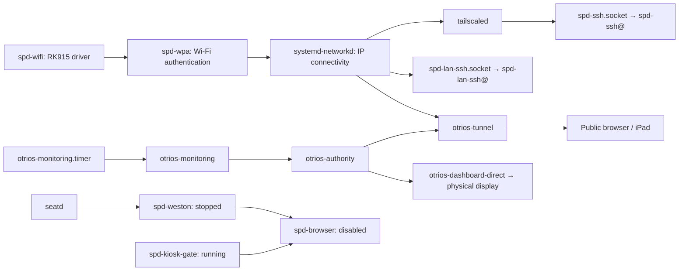

<!-- SPDX-License-Identifier: Apache-2.0 -->
# Frame service inventory — 2026-10-25

Read-only inspection of SPD-DASH-0001 / `100.73.221.26`, using `systemctl show`,
unit definitions, installed launcher scripts and listening sockets. This records
the observed configuration; it does not change service enablement.

## OTriOS

| Unit | Observed state | Responsibility and consumers |
| --- | --- | --- |
| `otrios-authority.service` | Running, enabled | Signed release files, discovery, app admission, sessions and durable app state. Trusted listener `127.0.0.1:8876`; public listener `127.0.0.1:8877`. Native display and tunnel request it; Monitoring explicitly requires it. |
| `otrios-dashboard-direct.service` | Running, enabled | Release agent verifies/caches signed builds, follows upgrades and launches the native KMS/GBM/GLES renderer with touch calibration and rotation 90. Requests authority and Tailscale. Explicitly conflicts with old Weston/browser units. |
| `otrios-tunnel.service` | Running, enabled | Cloudflare Tunnel forwards the public site to the public loopback authority listener. Metrics listen at `127.0.0.1:20249`. Required for public browser access; not local native display. Requests network-online and authority. |
| `otrios-monitoring.service` | Periodic one-shot, last run successful | Fetches Prometheus HTTPS data and publishes the Monitoring presentation. Requires authority; orders after network-online and Tailscale. Other apps do not depend on it. |
| `otrios-monitoring.timer` | Waiting, enabled | Schedules the collector every five minutes. |

`otrios-dashboard.service` has no installed unit. The name remains in the native
service's conflict/order declarations as an older display implementation.

## SPD platform and original kiosk

| Unit | Observed state | Responsibility and consumers |
| --- | --- | --- |
| `spd-wifi.service` | Active/exited, enabled | One-shot `modprobe rk915`; prepares Wi-Fi hardware. Requested by `spd-wpa`. Completed setup remains active without a daemon. |
| `spd-wpa.service` | Running, enabled | Per-interface `wpa_supplicant` on `wlan0`; Wi-Fi authentication. Requests Wi-Fi driver setup and binds to the WLAN device. IP configuration is supplied separately by systemd-networkd. |
| `spd-ssh.socket` | Listening, enabled | SSH bound to `tailscale0` at the frame's Tailscale address, port 22. Activates `spd-ssh@.service` per connection; our deployment access uses this path. |
| `spd-ssh@.service` | On-demand template | Runs `sshd -i` using the SPD SSH configuration for each accepted VPN connection. A running instance disappears after its connection closes. |
| `spd-lan-ssh.socket` | Listening, enabled | IPv4 port 22 bound specifically to `wlan0`, despite the wildcard address shown by `ss`. Supplies direct LAN maintenance access. |
| `spd-lan-ssh@.service` | On-demand template | Equivalent per-connection SSH worker for the Wi-Fi socket. |
| `spd-kiosk-gate.service` | Running, enabled | Python readiness page on `127.0.0.1:8765`; checks the old Grafana health endpoint every two seconds and redirects the old browser when ready. Only the old browser requires it; current OTriOS does not consume it. |
| `spd-weston.service` | Stopped, enabled | Original Wayland compositor; requires `seatd`. Original browser requires it. Stopped by the native display's conflict policy. |
| `spd-browser.service` | Stopped, disabled | Cog/WPE browser under Weston, starting at the readiness page and retaining its authenticated browser profile. Requires Weston and the gate; conflicts with the active native display. |
| `spd-zram.service` | Active/exited, enabled | One-shot setup of 256 MiB LZ4-compressed RAM swap. Benefits system memory pressure generally; ordered before the original browser. |
| `spd-usb.service` | Inactive, enabled with condition | Optional USB serial gadget. Requires the `/etc/spd-kiosk/usb-maintenance` marker to run; then starts `serial-getty@ttyGS0`. Not required for normal OTriOS operation. |

## Dependency paths

Arrows indicate functional consumers; they do not all mean systemd `Requires=`.

`Wants=` starts a related unit without making its continuous availability a hard
requirement. `After=` orders startup; it does not start the other unit by itself.
`Conflicts=` prevents the native and old display paths from running together.

The unused running gate is a cleanup candidate: it still polls Grafana while its
browser consumer is disabled. Weston is still boot-enabled but is stopped when
the native display starts. Neither was changed during this inspection.
