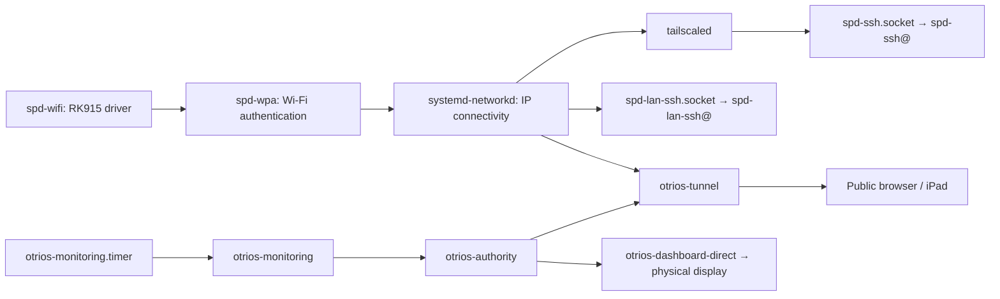

<!-- SPDX-License-Identifier: Apache-2.0 -->
# Frame service inventory — 2026-10-25

Inventory of SPD-DASH-0001 / `100.73.221.26`, updated after the requested legacy
kiosk removal. Evidence comes from unit definitions, installed launcher scripts,
listening sockets and before/after process identities.

## OTriOS

| Unit | Observed state | Responsibility and consumers |
| --- | --- | --- |
| `otrios-authority.service` | Running, enabled | Signed release files, discovery, app admission, sessions and durable app state. Trusted listener `127.0.0.1:8876`; public listener `127.0.0.1:8877`. Native display and tunnel request it; Monitoring explicitly requires it. |
| `otrios-dashboard-direct.service` | Running, enabled | Release agent verifies/caches signed builds, follows upgrades and launches the native KMS/GBM/GLES renderer with touch calibration and rotation 90. Requests authority and Tailscale. Obsolete Weston/browser ordering and conflict references were removed. |
| `otrios-tunnel.service` | Running, enabled | Cloudflare Tunnel forwards the public site to the public loopback authority listener. Metrics listen at `127.0.0.1:20249`. Required for public browser access; not local native display. Requests network-online and authority. |
| `otrios-monitoring.service` | Periodic one-shot, last run successful | Fetches Prometheus HTTPS data and publishes the Monitoring presentation. Requires authority; orders after network-online and Tailscale. Other apps do not depend on it. |
| `otrios-monitoring.timer` | Waiting, enabled | Schedules the collector every five minutes. |

`otrios-dashboard.service` has no installed unit; its obsolete native-service
conflict/order references were also removed.

## SPD platform and original kiosk

| Unit | Observed state | Responsibility and consumers |
| --- | --- | --- |
| `spd-wifi.service` | Active/exited, enabled | One-shot `modprobe rk915`; prepares Wi-Fi hardware. Requested by `spd-wpa`. Completed setup remains active without a daemon. |
| `spd-wpa.service` | Running, enabled | Per-interface `wpa_supplicant` on `wlan0`; Wi-Fi authentication. Requests Wi-Fi driver setup and binds to the WLAN device. IP configuration is supplied separately by systemd-networkd. |
| `spd-ssh.socket` | Listening, enabled | SSH bound to `tailscale0` at the frame's Tailscale address, port 22. Activates `spd-ssh@.service` per connection; our deployment access uses this path. |
| `spd-ssh@.service` | On-demand template | Runs `sshd -i` using the SPD SSH configuration for each accepted VPN connection. A running instance disappears after its connection closes. |
| `spd-lan-ssh.socket` | Listening, enabled | IPv4 port 22 bound specifically to `wlan0`, despite the wildcard address shown by `ss`. Supplies direct LAN maintenance access. |
| `spd-lan-ssh@.service` | On-demand template | Equivalent per-connection SSH worker for the Wi-Fi socket. |
| `spd-zram.service` | Active/exited, enabled | One-shot setup of 256 MiB LZ4-compressed RAM swap. Benefits system memory pressure generally; the obsolete browser ordering reference was removed. |
| `spd-usb.service` | Inactive, enabled with condition | Optional USB serial gadget. Requires the `/etc/spd-kiosk/usb-maintenance` marker to run; then starts `serial-getty@ttyGS0`. Not required for normal OTriOS operation. |

## Dependency paths

Arrows indicate functional consumers; they do not all mean systemd `Requires=`.

`Wants=` starts a related unit without making its continuous availability a hard
requirement. `After=` orders startup; it does not start the other unit by itself.

## Removed legacy display services

- `spd-weston.service`: old Wayland compositor.
- `spd-browser.service`: old Cog/WPE kiosk browser.
- `spd-kiosk-gate.service`: unused Grafana startup page and polling worker.
- `seatd.service`: seat-management daemon whose only configured consumer was
  Weston; its socket had no connected clients.

The three custom SPD units, boot links and `browser-wpe`/`gate.py` launchers were
deleted. The package-owned seatd unit was removed by purging **only** `seatd`,
with autoremove disabled. Shared graphics libraries, Wi-Fi, SSH and zram remain.
The native service and direct-renderer benchmark now reference only the active
native display path. No reboot or native/authority/tunnel restart was needed.

Before removal, the frame was already on release
`844fe3dc71aa5a4eedb6807cf789400fd9a699fa61c2854316ae35f64a62aba8` with a missing
`authority/apps/layout-lab/signal/ui.flex`. Both health endpoints returned 503;
the native process was alive but its mount was unconfirmed. This differs from
the earlier confirmed startup rollout and predates this cleanup. The cleanup
does not repair or replace that active release or app State.

See [removal evidence](data/legacy-kiosk-removal-2026-10-25.json) for before/after
health and process identities. `bash scripts/check.sh` passed (186 Rust tests,
41 Python checks); no new runtime build or protocol change is required.
