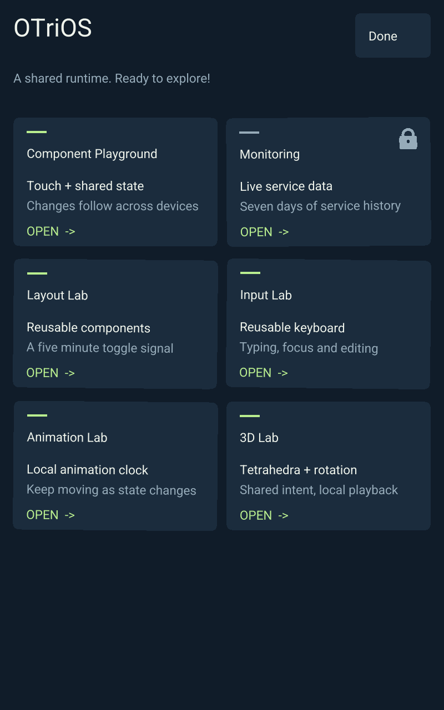
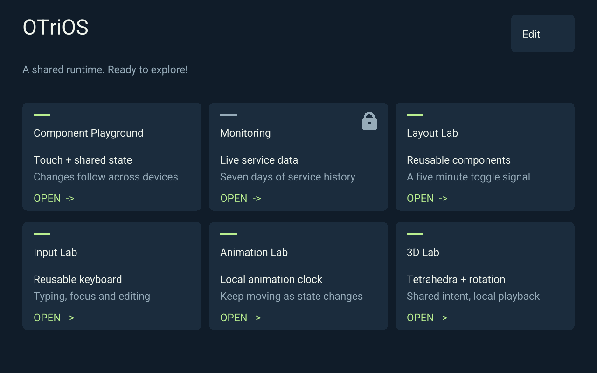

<!-- SPDX-License-Identifier: Apache-2.0 -->
# Editable Home acceptance

Home now stores one stable position field per card. Edit/Done, drag capture and
wiggle are local to a mount; other clients receive position changes and animate
reflow on their presentation clock. A wrapping flow preserves the existing card
components in both orientations. See [RFC 0015](../rfcs/0015-editable-home-reflow.md).

The implementation is committed in `1323535`, with native catalog-reference
startup and headless regression coverage in `5514324`. The native owner selects
both UI and State references from the admitted catalog, including local navigation
and versioned state roots.

Validation used `bash scripts/check.sh`, the browser host Node/Wasm checks,
all-feature ARM Clippy and a native release build. All 180 Rust tests, 39 Python
checks and 47 JavaScript/Wasm checks passed. The standard checks now include six
headless tests of the actual native app owner without requiring a DRM device.

Two real Chromium/WebGL clients exercised touch dragging, shared updates before
release, keyboard reordering/focus, stable component identities, rotation during
capture, restored navigation after Done, and portrait/landscape layouts. One move
changed one text position field and sent 140 client binary bytes across two frames
(write and acknowledgment). Edit mode/wiggle and twelve repeated samples within
the same slot added no state traffic. These are one measured gesture and bounded
correctness checks, rather than a throughput or physical-touch benchmark.

The signed release, native readiness, remote order-following check and public
HTTPS results are recorded in [the evidence JSON](home-card-reordering.json).
Browser touch was automated; physical touch on the installed frame was not tested.

The deployed release is `c2598ca4a76831f669ebda1fd5a23fc9e384751ddb1ddc1887fef20f13b73dd8`.
The real GLES2 renderer reported confirmed Home state, its existing shared order
`[1, 5, 4, 2, 3, 6]`, and editing disabled. A separate read-only session's Merkle
snapshot decoded through the core StateAdapter produced the same order. This
preserved the order already on the authority. All 70 public HTTPS conformance
checks passed. The final correction changed only the native executable in the
signed release; web and app bytes match the two-browser acceptance build.
