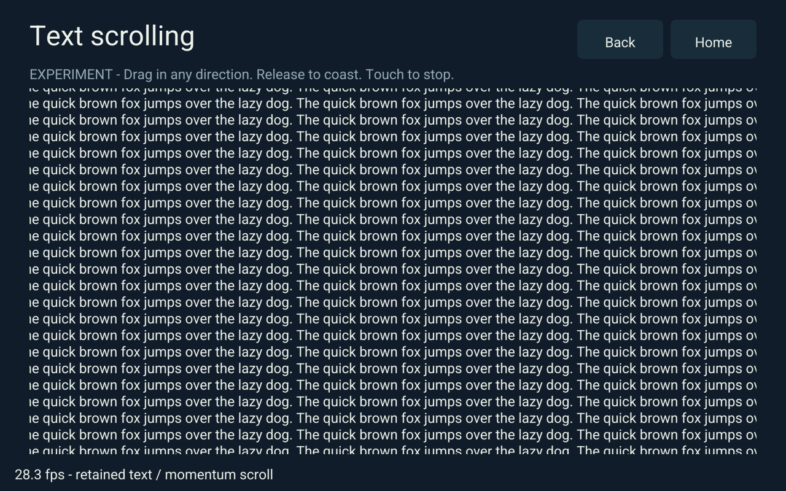
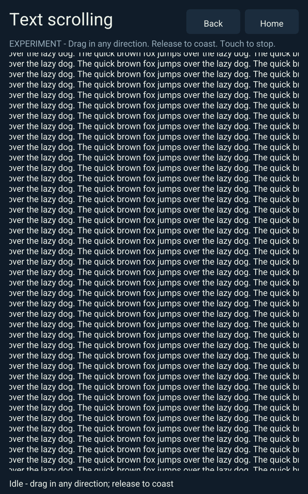

<!-- SPDX-License-Identifier: Apache-2.0 -->
# Layout Lab text scrolling experiment, 2026-10-27

Source: `a4960030beb7b2808f3764f7ea00102beb51c439`, stacked on the qualified
fixed-layout/retained-text evaluation. This workload makes the existing viewport
renderer inspectable. It does not enable the proposed RFC 0019 migration.

Open **Layout Lab → Text scroll demo**, or `/layout-lab/text-scroll`. The clipped
page contains 64 numbered rows, about 14,000 characters, with text beyond both
viewport axes. Drag to pan, release to coast, and touch to interrupt momentum.
The viewport has hard bounds. Back returns to Layout Lab; Home opens the launcher.
Offsets and velocity stay in client RAM and produce no shared State commands.

The footer counts native completed page flips or browser drawn frames during
interaction. It shows Idle when stopped; it does not maintain an idle redraw
loop or count the state worker's tick rate as FPS.

## Native trial

Actual Cortex-A7/Mali-400, Rust 1.90.0 release build, physical 800×1280,
rotation 90, logical 1280×800, accepted touch calibration, production RGB565
scanout, default 2× coverage atlas (4 MiB), existing framebuffer blending.
The hash-checked executable and admitted packages ran from a disposable directory.
Production direct display was stopped under the exclusive display-trial lock;
the original service and console mode were restored in `finally`.

Synthetic `ABS_X`, `ABS_Y`, `BTN_TOUCH`, `SYN_REPORT` events were written through
the existing evdev device, exercising the calibrated native input reader. This
is automated input evidence, not a claim of a physical finger trial. Three
2.5-second opposing drags were followed by release and momentum; both offsets
advanced after release, with zero pending shared commands. A captured frame was
visually checked for pane clipping, text, navigation and FPS footer.

| Measurement | Result |
| --- | ---: |
| Kernel completion rate over measured interactive interval | 27.46 fps |
| Kernel interval p50 / p95 | 35.307 / 35.313 ms |
| HUD at capture | 28.3 fps |
| Compose + submit p50 / p95 | 6.111 / 8.149 ms |
| Glyph misses, total trial | 63 |
| Coverage atlas allocation | 4,194,304 bytes |

The trial includes startup, interaction, HUD work and a capture stall (264.8 ms
maximum completion interval). It is not the isolated renderer benchmark. This
interactive workload has **not reached 30 fps**; keep that result separate from
the existing unchanged dense renderer fixture's 35–36 fps result. Do not lower
text density or alter that fixture to pass its gate. Profile end-to-end CPU and
GPU/submission work before selecting a fixed/SIMD or vertex-format change.

[Native measurements and gesture trace](data/layout-text-scroll-2026-10-27/native-trial.json).

## Browser and repository checks

`bash scripts/check.sh` and `OTRIOS_CHECK_FIXED_UI_MATH=1 bash scripts/check.sh`
passed, including child-process socket/state tests. These are dashboard/scaffold
checks; they do not satisfy the unimplemented Linux shared-memory PoC gates.
The staging builder repeated core/dashboard tests, shader generation checks,
web build, 47 Node host/worker/catalog/GPU tests and browser syntax checks.

Real Chromium/WebGL (SwiftShader) verified the Layout Lab child route, both-axis
drag/release momentum, cancellation, independent second-client offsets, portrait
bounds, Back/Home and responsive existing controls. The reported ~32 browser fps
is a software-renderer observation, not native GPU evidence. Core tests assert
that retained mesh/style `Arc` identities and snapshot bytes survive scrolling,
visible ranges cull most of the full page, and overscroll reverses immediately.

[Browser measurements](data/layout-text-scroll-2026-10-27/browser-local.json).

All six real native GPU tests passed on Mali-400 in each 2×, 3× and analytic
sampling mode (the qualified stable-quad test configuration), including clipping, fallback ordering, color transfer and Roboto
rotation checks ([log](data/layout-text-scroll-2026-10-27/native-gpu.log)).

No raster shader, coordinate quantizer or GPU vertex format changes in this
increment. Prior fixed/float pixel baselines remain controls; this demo's new UI
captures are inspection evidence, not replacement pixel baselines. Future
GLES2 `GL_FIXED`/`GL_SHORT` trials must retain those pixel gates and complete-frame
performance comparisons as specified in [RFC 0019](../rfcs/0019-native-fixed-simd-pipeline.md).

## Signed deployment

Activated release `c08c3e68c509554dd354ec3d4674504ce07a49f165cb6df803e038f69a45480f`
from the source above, after protected operational rollback backups. The frame
verified the complete signed replica before activation. Installed native/server
hashes match the staged executables; authority, direct display and tunnel all
report active. Native runtime/UI release identities agree, input is calibrated,
and state is confirmed with reload ready.

The deployed browser passed the same two-axis scrolling/local-state/portrait/
navigation checks. Public host conformance passed 99 signed asset, bootstrap,
protocol and isolation checks; authenticated Monitoring login was not retested.
The native frame was opened through navigation-only calibrated taps and left at
`layout-lab/text-scroll`, offset zero, ready to inspect. Canonical app state was
not restored from a snapshot or edited by the scroll tests.

[Deployment acceptance](data/layout-text-scroll-2026-10-27/deployment.json) and
[live browser results](data/layout-text-scroll-2026-10-27/browser-live.json).
