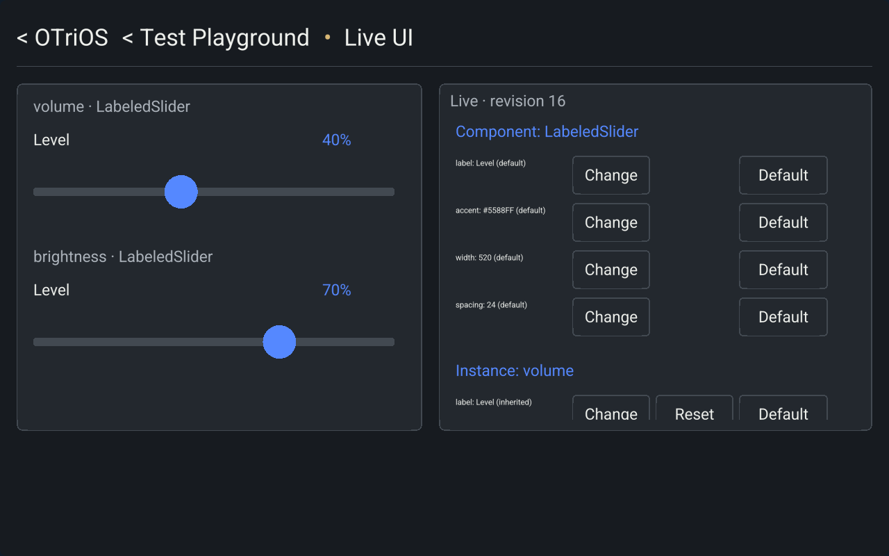

<!-- SPDX-License-Identifier: Apache-2.0 -->
# OIB O1 live qualification — 2026-11-02

Status: **implemented, validated and deployed**. The
[acceptance record](data/live-oib-2026-11-02/acceptance.json) covers the bounded
property-editing slice of [RFC 0029](../rfcs/0029-live-oib-ui.md). The
[OIB guide](../OIB.md) describes the implemented contracts and remaining scope.

The active signed Frame/Web release is
`718ee4957c62c4a225bd0a6e05d3db9ddf28a2e239b87932c55c4bf1341b44ef`.
It uses state protocol **v21**, Canvas OIB UI **v8**, required feature
`otrios-oib-v1` and the existing opening release-control **v1**.

| Artifact | SHA-256 |
| --- | --- |
| Browser Wasm | `fb0389415c409d43a967d240764d52b733cd7ce496fd28956cf23833df5e33a7` |
| Native ARM renderer | `8fc9fcba3076d1109c6f42461462c1a9d16ce0820b92acf76de470bd39b3f822` |
| Authority executable | `b35ac39c81e2c0694e356cb5ac844b7581e7f27bb02a6dd5656687ab9da9e39c` |

## Implementation and validation

Live UI is a companion app linked from Test Playground, with its own Space-owned
collection. The existing demos are separate attachments as well; navigation
hierarchy does not imply shared collection ownership. The existing Frame Admin
attached Live UI to the demo Space through the normal authority operation. No
identities, memberships, audiences, system privileges or service definitions were
added or changed.
No existing app schema was migrated or collection replaced.

The signed seed defines `LabeledSlider`, `volume`, `brightness` and their fixed
typed property cells. The authority stores draft causal registers, active cells,
activation/source hashes and durable receipts in the same app aggregate. UI
values travel through covered Merkle changes, not repeated compiled UI blobs.
The browser and native renderer resolve them through the shared runtime.

`bash scripts/check.sh` exited **0**, using the pinned Rust toolchain, locked
dependencies, two build jobs and two test threads. The log is
`target/oib-check.log`. This includes strict workspace Clippy, the Rust suites,
Python/Node checks, signed-bundle installation/recovery and the explicit final
real-authority process invocation. Its **33 process cases** passed with a freshly
built `OTRIOS_SPACES_SERVER`; earlier ordinary-workspace scaffold invocations are
not counted as process acceptance.

Relevant results include 244 core library tests, 69 Canvas cases and seven
dedicated OIB cases. The OIB cases cover inheritance, overrides and clears,
concurrent independent edits, retained same-property/clear conflicts, explicit
resolution, invalid/unauthorized writes, canonical register joins, snapshot and
journal recovery, stable scene/mount identity, held-slider layout deferral and
local inspector scrolling/taps. The new real-authority case seeds OIB into an
already persisted document, retains its nondefault content, denies Member UI
writes, replicates accepted Admin changes and recovers them after restart.

`cargo check -p otrios-sdk --features oib --locked --offline` also passed. The
browser Wasm and ARM direct host/authority builds passed, and frozen runtime
inputs matched the checkout. No production dependencies or unsafe code were
added. These are Canvas authority/runtime checks, not the Linux shared-memory
IPC acceptance milestones.

## Live browser and Frame acceptance

Two isolated Chromium contexts loaded the exact signed release using the existing
Frame Admin identity in temporary HttpOnly cookies. This exercises admitted
browser sessions; it does not claim a human password-login or Safari test.

The live checks established:

- A component accent edit updates both instances and both browsers. A component
  width edit changes their geometry and reaches the already mounted Frame.
- An instance label edit affects only `volume`; Reset resumes inheritance.
  Inspector panning stays local to its browser. The inspector remains nonmodal.
- Focus survives a remote UI edit. Dedicated workers and connection counts stay
  unchanged during the edits. Each context had two sequential startup connection
  attempts before its initial app mount; the test compares against that measured
  baseline rather than claiming only one opening attempt.
- The Frame receives the browser changes with the same renderer PID and mount
  epoch. A calibrated physical-reader tap on its inspector submits another UI
  edit, which both browsers explicitly observe before continuing.
- Ordinary slider values survive every UI edit. A browser refresh recovers the
  confirmed UI state. There are no browser runtime exceptions in the completed
  acceptance run.

The Frame used direct GLES2/DRM. Input was synthetic evdev through its real
calibrated reader, not observed human-finger input. The native executable's hash
matched the signed manifest; calibration stayed unchanged. The final Frame still
had the same PID and epoch, presented revision **16**, had confirmed state and
reported healthy authority/display/tunnel services. Component defaults were
restored and the instance override causally cleared through ordinary editor
operations.

One edit reached both browser presentations in **724 ms** in this run, including
CDP interaction, network time and a 100 ms polling interval. This is an observed
sample, not a latency benchmark or realtime deadline.

## Publication, recovery and remaining scope

The existing signed deployment workflow verified the complete release and inner
bundle closure before activating Frame/Web and publishing upgrade events. A
code-only recovery kit retains this qualified OIB-capable release, the matching
authority/native helpers and verifier. Its copied signed closure was verified
again against the existing publisher key. It contains no app data or credentials.
A separate cross-release rollback was **not exercised** in this task; the record
does not claim otherwise.

O1 has a fixed graph and the existing declarative event interpreter as its main
class. Structural graph edits, executable class/outlet APIs, free-text inspector
input and portable OIB data are still deferred. Live UI data export/replacement
is explicitly unavailable until its codec includes the OIB namespace; other apps
retain their existing transfers. No arbitrary module execution, transactions,
CRDT accelerator or Linux shared-memory runtime is introduced.
