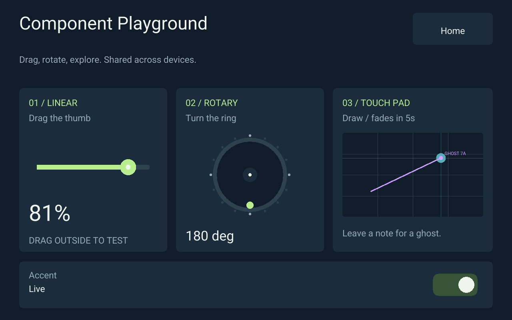
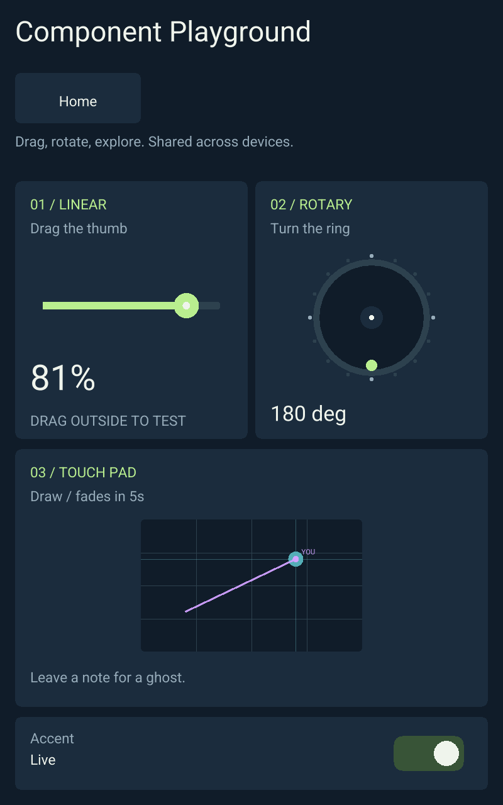

<!-- SPDX-License-Identifier: Apache-2.0 -->
# Modular screen layout validation — 2026-10-23

Home, Component Playground and Layout Lab now compose the same reusable
components into 1280×800 landscape and 800×1280 portrait scenes. Component
structure, styling, control identities and state bindings are shared between
profiles. Other apps retain their legacy logical scene and fit uniformly.
See [RFC 0012](../rfcs/0012-modular-screen-composition.md) for the contract.

## Checks

- `RUST_TEST_THREADS=1 bash scripts/check.sh`: passes (164 Rust tests,
  34 Python checks, formatting and strict workspace Clippy).
- `node --test scripts/test-dashboard-session.mjs scripts/test-dashboard-monitoring-session.mjs scripts/test-dashboard-artifact-cache.mjs scripts/test-app-catalog.mjs scripts/test-canvas-worker.mjs scripts/test-viewport.mjs scripts/test_gpu_scene.mjs`:
  all 43 tests pass.
- `cargo build -p otrios-web-host --lib --release --locked --offline --target wasm32-unknown-unknown`
  and the browser binding build pass; `node --test scripts/test-canvas-host-exports.mjs`
  passes against that Wasm artifact.
- In the ARM build container, `cargo clippy --workspace --all-targets --all-features --target armv7-unknown-linux-gnueabihf --locked --offline -- -D warnings`:
  passes, including the native GLES/touch host. Projection/touch unit tests cover
  all four rotations, portrait surfaces and legacy scene fitting.
- `node scripts/test-responsive-browser.mjs --url http://127.0.0.1:18877 --output target/responsive-browser`:
  passes in real headless Chromium using software WebGL and a disposable local
  authority. It checks Home column changes, pointer navigation, stable control
  identities, shared slider edits and ink between clients in different
  orientations, semantic focus retention, and input after resizing mid-drag.

The local authority used a disposable signing key and a placeholder native
artifact solely to serve a complete browser test fixture. It is not a deployment
artifact. No live service was changed. Physical frame panel orientation, calibrated
touch and device GPU performance remain untested.

## Browser captures

These are actual Chromium captures from the passing acceptance run.

| Screen | Landscape | Portrait |
| --- | --- | --- |
| Home | [Capture](modular-home-landscape.png) | [Capture](modular-home-portrait.png) |
| Playground | [Capture](modular-playground-landscape.png) | [Capture](modular-playground-portrait.png) |
| Layout Lab | [Capture](modular-layout-lab-landscape.png) | [Capture](modular-layout-lab-portrait.png) |

