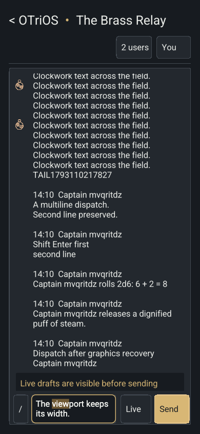

<!-- SPDX-License-Identifier: Apache-2.0 -->
# Phone readability and retained profiles — 2026-10-27

## Behavior

Chat browser widths below 600 CSS pixels now use a 534-unit logical viewport,
instead of 800. Text and controls become approximately 1.5× larger at the same
screen width. The header retains its aligned breadcrumb and room title, moving
member/profile actions to a second row. Keyboard opening still reflows height
without shrinking width or replacing the active editor. Tablet, desktop and
native density remain unchanged. Device pixel ratio affects raster resolution,
independently of this layout choice.

Messages retain their existing `Message { sequence, at, sender: Profile, kind,
text, nonce }` contract. The sender's stable ID resolves against the authority's
current profile when serving bounded history pages. Roster changes refresh
loaded message authors and avatars, including the browser accessibility log.
Only the bounded client window rebuilds, preserving its existing source anchor;
the full authority history is not rewritten. Message content and receipt
identities stay unchanged. When a profile has expired, the stored sender
snapshot remains the fallback. This retains the existing prototype channel;
it does not implement RFC 0024's collection leases.

The private guest record is:

```rust
struct Guest {
    profile: Profile,
    digest: String,
    last_seen_unix_ms: u64,
    cooldown: u64,
}
```

Leaving removes online membership and keeps the guest record. Quiet connected
readers checkpoint last-seen at most once per minute; departure records the final
authority-clock timestamp. Joins, messages, profile changes and kicks also update
the timestamp. A backward clock correction cannot decrease it. Profiles are
eligible for pruning after 30 days of absence, with the existing capacity bound.
`last_seen_unix_ms` keeps the serialized key `seen`, preserving journal and code
rollback compatibility. No state wire format changed: protocol v6 and the v1
release-control opening envelope remain in use.

Unix timestamps are independent of local time zones, but exclude leap seconds
and can be affected by wall-clock corrections. They support dates and retention;
message ordering uses authority sequence numbers. See the
[POSIX time rationale](https://pubs.opengroup.org/onlinepubs/007904975/xrat/xbd_chap04.html).

## Qualification

The regression coverage includes phone control bounds and heading fit, visual
viewport-only keyboard reflow, renaming loaded authors by ID without changing
another author with the same old name, current profiles in old history pages
after restart, append-only profile updates, quiet-reader checkpoints, departure,
backward clock correction and 30-day profile pruning.

`bash scripts/check.sh` passed. The signed builder passed its Rust checks and
all 69 Node tests. `scripts/test-chat-browser.mjs` passed against the exact signed
release on a disposable local authority, including two-client rename updates,
IME/native editing, wrapped input, graphics recovery and phone keyboard reflow.

At a 390-pixel CSS width, the composer font measures 16.4366 CSS pixels. The
scale factor relative to the earlier 800-unit phone layout is 800/534 = 1.4981.
The simulated keyboard changes only the visual viewport from 390×844 to 390×420
with a 50-pixel top offset. Canvas width remains 390 pixels immediately and after
reflow, and editor focus, value and selection remain unchanged. This is a browser
simulation; the larger density still needs the user's physical iPhone check.

Evidence: [browser acceptance](assets/phone-readability-and-profiles-2026-10-27/acceptance.json),
[phone measurements](assets/phone-readability-and-profiles-2026-10-27/mobile-reflow.json),
[native readiness](assets/phone-readability-and-profiles-2026-10-27/device-verification.json)
and [public asset verification](assets/phone-readability-and-profiles-2026-10-27/public-verification.json).




## Deployment

Release `efbe386e30d5b81084a6b789978a1edde9d4b7acbdeb7f08bd5e87ac764490da`
is active on the frame and public web authority. The running native executable
matches signed SHA-256
`4a60af6c10974b44e84a89c81c1d5a5bbdae72e6b1db323f2efa2f0acc57b4a3`.
Readiness confirms chat state, stream readiness and zero pending commands;
authority, display and tunnel services are active. The public manifest and
selected JS/Wasm assets match their declared hashes. Touch calibration remains
`44f2b33a3a17140e6c662b9feba1f009c9ed7910f2c1fa2178b7f5a24a53859e`.

Previous code release `e610e281164c083987391c7f8760e3dc8d666d770fa4cf8238b20dcced1c1dcf`
and service binaries are retained at
`/var/lib/otrios-authority/rollback/2026-10-27-phone-readability`.
No chat-history backup or journal rewrite was required.
