<!-- SPDX-License-Identifier: Apache-2.0 -->
# Space admission qualification — 2026-11-01 JST

## Authority-bound chat profile preparation

The full `bash scripts/check.sh` suite passes for the authority-bound profile
preparation, including 24 covered chat tests and both real chat process scenarios.
Added tests preserve app-local profiles through restart and guest expiry, keep
authority identities and resume secrets out of room events, reject duplicate or
rebound saved actor mappings, and abandon revoked presence without writing an
unlinked journal. The session adapter still rejects managed chat; this is a
runtime prerequisite, not managed chat or physical Frame acceptance.

An initial full run failed because the chat restart helper connected to the
private listener after waiting only for the earlier public listener. The helper
now waits for both listeners with a bounded deadline and child-exit check. The
isolated recovery scenario and subsequent full suite pass.

Qualified source: `cf43975fdc73e13c2f8aa46d903e1be6220a08d9` on
`feat/spaces-and-app-data`, with a clean source tree. This is the authority and
browser admission increment of [RFC 0027](../rfcs/0027-spaces-and-app-data.md), not
completion of all four milestones or a Frame deployment. The [management guide](../SPACES.md)
records the current contracts, rollout procedure and unavailable lifecycle stages.

## Results

- Nine covered runtime tests pass for roles, multiple Admins, last-Admin protection,
  binding identity, retained collection identity, revocation/readmission, current
  installed-policy constraints and registry framing recovery.
- Real authority/child-client scenarios pass for independent Space values,
  unauthorized reads/writes, explicit Frame identity, active revocation/reconnect,
  Member management denial and concurrent last-Admin changes.
- Offline provisioning preserves a confirmed legacy value through journal replay,
  migration and restart. A completed manifest does not regrant a revoked member;
  a failed import leaves admission unavailable. Omitting the CLI flag does not
  reopen legacy access to a migrated state directory.
- A separately bound Monitoring collector can publish its collection's view;
  human Admins cannot publish it, and the collector receives no human membership.
  An independently attached Monitoring collection receives none of that view.
- The native owner test revokes a held frame before renderer credit returns for
  both private apps and ordinary apps used inside a Closed Space.

The repeatable Chromium probe signs in through the normal form using independent
cookie contexts. Two clients see Space A change from 0 to 1, while Space B stays 0.
Anonymous and authenticated non-Members receive denial. Removing the Member clears
that client's view; the remaining Admin continues editing Space A to 2. The probe
reports no runtime exceptions and preserves release-control v1.

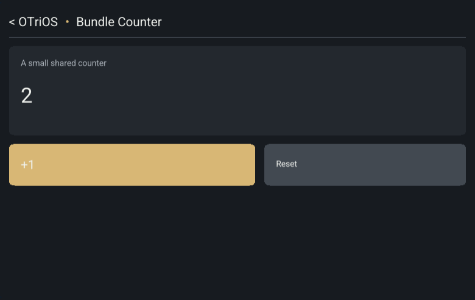

The [machine-readable report](data/spaces-admission-2026-11-01.json) records source,
authority/Wasm artifact digests and the signed browser fixture ID. The fixture
contains real browser and app bytes, with disposable signing keys and test data;
it contains no native executable and was never activated on Frame.

## Commands and limits

`bash scripts/check.sh` passed, including strict Clippy, workspace tests, real
process/session/bundle checks and Linux evdev fixtures. The native held-frame
case also passed directly through `cargo test -p otrios-dashboard --features
server,canvas,host-sync --test native_owner
app_transport_receives_remote_edits_reconnects_and_revokes_a_held_frame --locked
--offline`.

The browser build used Rust 1.90.0, the `wasm32-unknown-unknown` target and pinned
wasm-bindgen 0.2.129. After building the authority/example and web package from the
tested source, `python3 scripts/qualify-spaces-browser.py` passed against freshly
created disposable authorities and isolated Chromium contexts. The probe shuts
down those authorities and removes test credentials/signing keys afterward.

One intermediate full run failed the existing retained-document keyed-window
packing-count test. It passed in isolation and in subsequent full runs; no
retained-document code was changed for this increment.

This report establishes local authority/browser behavior and native-owner adapter
behavior. ARM execution, physical Frame presentation, signed live cutover and its
rollback remain unqualified here. No Linux shared-memory IPC claim is made.

## Collection-aware mount checkpoint

Clean source `9392387753f91f667b7e1a6ea2cb39e9513efbf5` passed the full
`scripts/check.sh` suite and the same rebuilt Chromium qualification with zero
runtime exceptions. The [v9 report](data/spaces-mount-binding-2026-11-01.json)
records the exact authority/Wasm digests and fixture release. Release-control v1
is unchanged; state protocol v9 carries the collection/action binding and first
aggregate view before candidate acceptance. Added runtime tests distinguish
same-collection pending-intent recovery from replacement-collection or read-only
admission, and prove read admission cannot allocate writer receipts or gain write
capability. This checkpoint also remains local qualification only.

## Shared-session discovery checkpoint

Clean source `9f94f26142c1280fa7e3b649704fa352072abebb` passed the full
`scripts/check.sh` suite, 14 direct Node session tests, and the rebuilt Chromium
probe with zero runtime exceptions. The [v10 report](data/spaces-discovery-2026-11-01.json)
records its exact artifacts. Added covered checks exercise metadata filtering,
the maximum-size snapshot, malformed management frames and lost-reply recovery
without management replay. A real shared-session scenario races initial capture
with attachment, observes subsequent changes, rejects Member management and
removes a revoked Member's closed-Space metadata. This qualifies the channel and
host adapters; shared Apps & Data controls and physical Frame remain pending.

## Current-policy activation checkpoint

Clean source `1401d2f5408d8538c5ceb12d2c435cc3a0cb3969` passed the full
`scripts/check.sh` suite and rebuilt Chromium qualification with zero runtime
exceptions. The [v11 report](data/spaces-activation-2026-11-01.json) identifies its
artifacts. Managed candidates now remain invisible until an authority Activated
reply. Covered tests hold protected candidate state/aggregate content offscreen,
discard denied/disconnected/cancelled candidates and preserve late reconnect
edits only within matching bindings. A real authority scenario revokes membership
between qualification and acceptance, receives denial rather than activation,
rejects the subsequent write and verifies unchanged data through another client.
These results still do not establish physical Frame acceptance.

## Owned-document collection checkpoint

Clean source `707d8e98777550c337e05ec6fbc5568c39e97191` passed the full
`scripts/check.sh` suite and rebuilt Chromium probe with zero runtime exceptions.
The [report](data/spaces-owned-documents-2026-11-01.json) records its artifacts.
Fifteen covered Space tests include the canonical collection schema; seven tests
in the real process suite include two confirmed legacy documents migrating into one app
collection, independent documents and Space isolation, restart without an explicit
registry flag, and incompatible-code rejection without checkpoint replacement.
Restoring compatible code reopens the original identities and values. Browser
qualification retains the existing separate-client admission checks; the
multi-document/migration scenario is authority process evidence. Frame and the
remaining lifecycle controls are still pending.

## Shared host controls and retained removal checkpoint

Clean source `fa29e9aa0b7778cd73d066ffb812b24e09e75350` passed the full
`scripts/check.sh` suite and rebuilt Chromium qualification with zero runtime
exceptions. The [report](data/spaces-host-controls-2026-11-01.json) identifies the
source, authority/Wasm bytes and signed disposable fixture. State protocol v11
and release-control v1 remain unchanged.

Sixteen covered Space tests, nine host UI tests and eight tests in the real
authority process suite pass (seven authority scenarios plus the child-client
entry test). The UI checks cover role-filtered controls, responsive bounds,
local-only forms, stale roster redaction, publisher/host action separation,
confirmation before Quit, reconnect denial and Home/discovery ordering. The
process scenarios prove removal revokes an active client, preserves Admin-visible
data and restores the same collection/value after restart and reattachment.
Configured collector principals cannot create Spaces or acquire human roles.
The ten native owner tests also pass, including held-frame revocation and the
Space-selection helper; these are adapter tests without physical Frame hardware.

The browser probe uses the shared host controls to Quit while another participant
continues editing, remove the app and revoke that participant, inspect retained
data, reattach the original collection/value, and switch to the isolated second
Space. Space A ends at 3 while Space B remains 0.

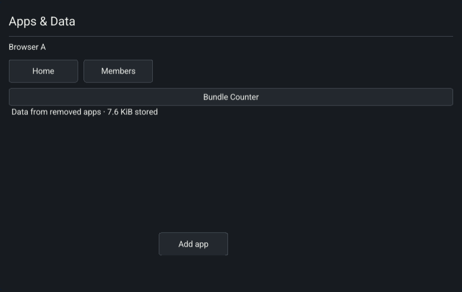

An intermediate full run encountered a connection reset in the existing
release-bootstrap integration test. Its isolated rerun and the final complete
suite passed. Local uninstall, collection-owned auxiliary channels, durable
deletion, public sharing and physical Frame deployment remain pending.

## ARM emulation qualification

The clean `fa29e9aa0b7778cd73d066ffb812b24e09e75350` source archive builds the
ARMv7 host, authority, collector, session bootstrap and app packer using Rust
1.90.0 and the matching ARM C compiler/archiver. ELF inspection confirms ARM
machine code. The [report](data/spaces-arm-emulated-2026-11-01.json) records the
artifact hashes, compiler configuration and emulator version.

All eight top-level process tests pass against the ARM authority under QEMU:
seven authority scenarios and the child-client entry helper. They cover Space
isolation/admission, shared discovery, staged revocation, confirmed legacy-root
migration, collector separation and retained removal/reattachment. The later
264-document cache-pressure case was validated natively in `bf8e371`; it is not
part of this older ARM source qualification.

The builder initially selected a host C compiler despite its ARM Rust linker.
The corrected configuration explicitly selects target CC/AR; `72894de` also
tracks those settings in the build script and rejects an implicit host compiler
for a cross build. The modified script was separately run with the real ARM
compiler and its generated objects inspected. Its full required suite passes.

QEMU uses the container's installed armhf runtime libraries (`-L /`), rather than
the linker's cross sysroot. These unsigned binaries were never activated on
Frame. This evidence establishes emulated authority execution; physical display,
touch, signed activation and rollback still require Frame acceptance.

## Scoped ink and observation-fence checkpoint

Clean source `bc6f2ceae9f81a2d3cecfaaecd4b177b7854d8f8` passed the full
`scripts/check.sh` suite and rebuilt Chromium qualification with no runtime
exceptions. The [report](data/spaces-ink-2026-11-01.json) identifies its artifacts.
State protocol v12 scopes auxiliary payloads by accepted mount epoch and fences
discovery refreshes with echoed observation IDs; release-control v1 is unchanged.

The covered checks include 16 Space tests, ten host UI tests and two auxiliary
frame tests. Ten top-level process tests pass: nine authority scenarios plus the
child-client entry helper. The new ink scenario checks accepted versus staged
admission, isolation by Space/app/document, stale epochs, subscription release on
Quit, membership/attachment revocation, unaffected sibling use and fresh trails
after reattachment. The metadata ordering regression checks that a delayed old
snapshot cannot satisfy a new observation, repaint a roster or strand a removed
app. All 13 browser-worker tests pass and now run in the required suite, including
cookie revocation before reconnect and renderer-credit-independent redaction.

Real Chromium pointer strokes reach a second client in the same Space. Another
Space receives neither live points nor recent history after resubscribing.
Drawing continues after one participant quits. The same probe also repeats the
counter lifecycle and Space-picker checks.

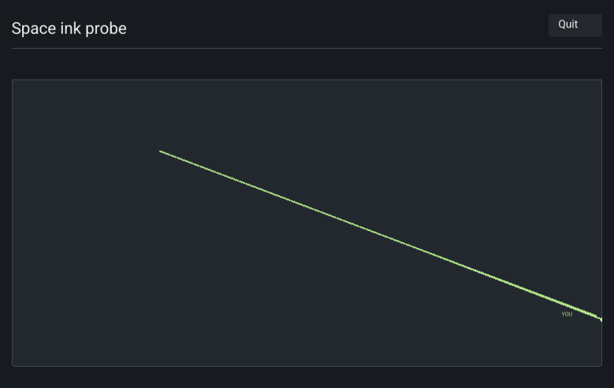

This is local authority/browser evidence. The earlier ARM-emulation report names
its older source explicitly; physical Frame acceptance remains pending. Managed
chat/collection integration, local uninstall, durable deletion and public sharing
are still required before RFC completion.

## Collection-owned chat and first transcript checkpoint

Runtime source `1a169b07f5ad1898e4529d66f06a82dc5ef8ecac` passed the full
`bash scripts/check.sh` suite. Clean source
`a6f09f6dc130561364dbf6752945e93738f22ca6` additionally qualifies the browser
driver correction described below. Its rebuilt authority/Wasm fixture passes
Chromium acceptance with zero runtime exceptions; the
[report](data/spaces-chat-2026-11-01.json) records exact source, artifact hashes
and the signed disposable fixture. State protocol v13 adds the first transcript;
release-control v1 remains unchanged.

Twenty-five covered chat tests, 67 Canvas tests and eleven top-level Space process
tests pass (ten authority scenarios and the child-client helper). Added checks
qualify a bounded 64-message transcript without creating presence or writing a
journal. Its text is prepared incrementally before Accept, remains offscreen
until Activated, and is discarded if revoked while preparing. The first document
frame already contains readable glyphs before any active tick or Welcome. Tests
include a full Unicode/64-avatar window and header controls in landscape,
portrait and phone-sized views. Chat uses one host-owned Quit control without
covering Members or profile controls.

The real authority scenario isolates transcripts by Space, app and owning
document. Native access uses an explicit Frame identity; room commands cannot
choose an authority actor or resume a guest credential. Quit leaves another
participant sending, revoked sends are rejected, removal/restart/reattachment
recover the same collection, messages and app-local profiles, and a corrupt
replacement transcript leaves the previous activation usable. These are process
adapter tests, not physical Frame execution. All 37 direct Node assertions pass
across the worker, shared session and cookie-session checks.

The Chromium probe uses independent cookie contexts and the real Brass Relay UI.
Two clients share a transcript while another Space stays empty. A participant
continues sending after the other quits; reopening restores that participant's
profile. Removal clears the other client's transcript, and reattachment restores
the retained messages. The counter, discovery, revocation and ink checks also pass.

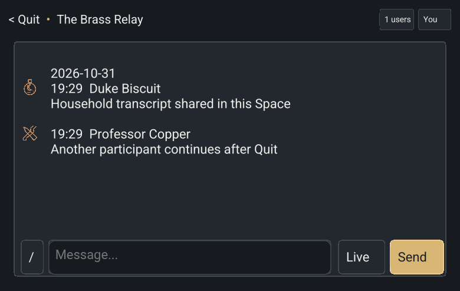

An initial clean probe cancelled its second synthetic ink stroke. Outgoing and
relayed samples matched; DOM tracing identified capture loss during a CDP drag
move that omitted `button: 'left'`. The driver now supplies both the pressed
button and bitmask and checks complete capture acquisition/release for both
strokes. Two consecutive runs and the clean run pass without temporary dispatch
hooks. The [input trace](data/spaces-chat-input-2026-11-01.json) records the clean
pointer/capture sequence. No ink runtime change was needed for this correction.

Explicit import of pre-Space chat history, device-local uninstall, durable
deletion and public sharing remain pending. This checkpoint makes no v13 ARM,
physical Frame or live-cutover claim.

## Explicit legacy chat migration checkpoint

Runtime source `c16f588bf4651119526c59e40e106808bf33de4e` passed the full
`bash scripts/check.sh` suite, including thirteen top-level Space process tests
(twelve authority scenarios plus the child helper). Two added migration scenarios
cover 70 confirmed legacy messages, older-window reads, source ownership across
processes, torn-tail recovery, independent fresh roots/Spaces, subsequent confirmed
writes, restart and no membership regrant. Missing/corrupt sources, conflicting
destinations and missing completed destinations fail without empty replacement.
Pending provisioning keeps admission unavailable after failure.

Chat import requires manifest version 2; v1 with an import declaration is rejected
before provisioning starts. A completed private import receipt validates the
current destination without replaying old data, including when the old source is
gone. Historical sender snapshots remain intact while an admitted Frame identity
gets its own profile.

Clean source `53ce0c5c12395f07e076ceaaca848a5caa52ea34` adds the migration browser
fixture. Its example passed targeted strict Clippy/build checks, and the fixture
tools passed syntax checks and real Chromium acceptance. The
[report](data/spaces-chat-migration-2026-11-01.json) records zero runtime exceptions,
exact artifacts and the signed disposable fixture. Both Members see the imported
legacy message in Space A; Space B receives none of that history. The probe also
repeats live sharing, Quit, removal and reattachment. Runtime/browser state
protocol v13 and release-control v1 are unchanged.

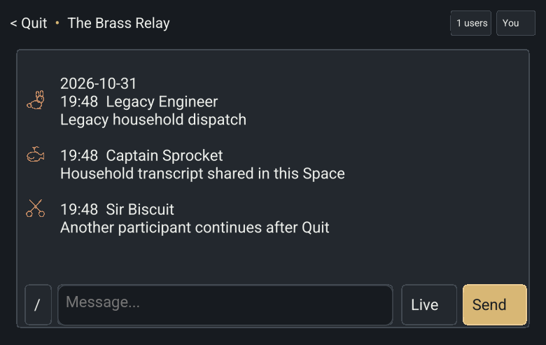

Permanent deletion and public sharing remain unfinished.
This is local process/browser migration evidence, not physical Frame acceptance.

## Device-local uninstall and chat revocation

Code checkpoint `ba4fe5f9919544ed1ee3b86966cc4fdce231826a` passed the full
`bash scripts/check.sh` suite (`/tmp/otrios-spaces-check-24.log`). The authority
binary SHA-256 was `b76c0d6622260b7c504c22d422b42b855407796d266c483d016842025cc69c82`.
State protocol v13 and release-control v1 are unchanged: installation metadata
and its notifications are device-local, not new shared-session messages.

- Fourteen covered host UI tests pass. Uninstall preserves a pending edit through
  confirmation, waits for captured release, cancels staged/accepted mounts, hides
  removed roots despite newer remote discovery, preserves the collection and
  signed catalog hash, leaves another participant usable, and reopens the same
  data after reinstall. Offline uninstall discards unconfirmed RAM intents and
  prevents them from resuming through reconnect or reinstall.
- A covered namespace test rejects invalid IDs, duplicate/unsorted roots and
  oversized root sets, removes child destinations, and keeps the trusted local
  Home available while invalid input closes app launches.
- Two native filesystem/IPC tests use independent Python writer processes and
  a real Unix socket. Concurrent writes preserve both removals, notifications
  resync the newest atomic snapshot, offline mutations survive observer restart,
  a second observer cannot steal the socket, and invalid file/socket types and
  permissions are rejected.
- The real native-worker test holds the display's only frame credit while an
  independent uninstall command runs. Its retained frame is revoked and redacted
  before replacement credit returns. These checks pass in the full thirteen-test
  native-owner suite; they do not use a physical display or touch device.
- Supervisor tests confirm that configured installation policy is passed as a
  required executable option, so an older binary cannot silently ignore it.

An earlier full run caught a managed-chat shutdown race: policy revocation could
end its auxiliary worker before the state worker delivered AccessRequired,
closing the shared socket early. The original real-process scenario reproduced
the failure on repetition 33. The adapter now distinguishes expected revocation
from failure of a still-authorized worker. The strengthened scenario verifies
that a revoked Member can refresh Home and that app removal still allows a new
authorized activation on the same socket. All 100 repetitions passed after the
fix, followed by the full suite, including all thirteen authority process tests.

This completes the S2 software increment. Permanent deletion, public sharing,
current ARM qualification and signed physical Frame acceptance remain outstanding.

## S3 decision-ledger foundation

Code checkpoint `5e7575a890e85c3602697bdd56dc79177e7592b4` passed the full
`bash scripts/check.sh` suite (`/tmp/otrios-spaces-check-25.log`). The authority
binary SHA-256 was `3f503859b70f2ab3c8875c26d78dbfd0136eee46facb43b6001ebef0a814d1a4`.
The private registry framing is now OTSP3; shared-session state protocol v13,
management v1 and release-control v1 are unchanged.

Eight covered store tests pass, including a separately invoked child helper.
Children exit without destructors at eight publication boundaries: before the
ledger, after its temporary-file sync/rename/directory sync, after those same
three primary-file steps, and before in-memory publication. Recovery preserves
the pre-decision binding before ledger replacement and applies the deletion
decision after it. Replacing the primary with an older snapshot cannot remove
the recovered tombstone or restore its collection identity. These are real
process-exit checks, not a simulation of power loss or storage hardware failure.

Additional cases verify exclusive ownership across atomic replacements,
missing-lock refusal, missing-primary reconstruction, missing-ledger refusal
even with an older OTSP2 backup, persistence poisoning and restart recovery,
partial initialization recovery, foreign/corrupt records, root pairing,
private permissions and symlink rejection. Ownership releases explicitly on
Drop so a concurrent process spawn cannot retain the lock through an inherited
descriptor while exec is still closing descriptors.

All sixteen existing registry/admission tests pass with legacy framing upgrades.
All fourteen authority process tests pass, including the new recovery scenario:
an older primary does not regrant a revoked Frame identity; the confirmed value
42 survives recovery; missing paired app storage and a missing ledger each keep
state unavailable while release hello still works; restoring the original
storage/ledger recovers 42 and keeps that identity revoked. Existing offline
document/chat migration and lifecycle checks also pass against this framing.

This is the S3 storage prerequisite. DeleteData remains unavailable through HTTP
and the shared session until producer shutdown, reclamation, backup/retention
workflows and cleanup reporting are integrated and qualified. No physical Frame
deployment or current ARM acceptance is claimed by these checks.

## S3 payload reclamation backend

Code checkpoint `e2af583678e0c4db6711ac265637d5dcd330b62b` passed the full
`bash scripts/check.sh` suite (`/tmp/otrios-spaces-check-26.log`). Six covered
reclamation tests pass, including a separately invoked child helper. The backend
requires a durable tombstone and producer quiescence. It rejects live collection
IDs and leaves all files intact while producers remain active.

Child processes exit at five cleanup boundaries. Restart retains the deletion
decision and finishes partial reclamation without changing another Space's
checkpoint, journal or presentation. Tests also reclaim chat/history/index and
migration-receipt files, interrupted replacement files, and more than 128 orphan
files through bounded pending/retry turns. Shared hard links and child symlinks
preserve the other collection's asset/history bytes; a symlink replacing the
collection directory is rejected. Reclamation is idempotent after completion.

This is backend evidence. Authority producer shutdown, cleanup reporting,
backup/retention and restore integration remain unfinished, so DeleteData is
still unavailable through management APIs. There is no physical Frame claim.

## S3 managed snapshots and fenced restore

Code checkpoint `4ce1dae437c95805a5eed88741fab532737c3d89` passed the full
`bash scripts/check.sh` suite (`/tmp/otrios-spaces-check-27.log`). The authority
binary SHA-256 was `4e2fe493ed927831f6d7b7c5f45ec9871b75bf16ab949627e0cc3a963815c31a`.
Private framing is now OTSP4 so earlier writers cannot ignore a pending restore.
State protocol v13, management v1 and release-control v1 are unchanged.

All 27 covered store tests pass, including their separately invoked child
helpers. Snapshot tests cover schema/history/asset retention, owner/control
exclusion, deleted collections, seven-day expiry, corrupt manifests, quotas,
symlink isolation and four real process-exit publication boundaries. Restore
tests cover six process-exit boundaries, corrupt staging that keeps admission
closed, safety snapshots, removal of later files, preservation of latest policy
and unrelated new collections, OTSP3 upgrades, and skipping deleted collections
whose old backup files have already been reclaimed.

All fifteen authority process tests pass. The new offline CLI scenario confirms
that a live authority excludes snapshotting; a confirmed value 42 can be backed
up, edited to 73 and restored to 42; and restoring payloads keeps the later
revocation of the separate Frame identity. A deliberately blocked replacement
leaves the restore marker durable and the restarted authority unavailable.
Repairing the target lets startup finish the plan before serving 42, without
restoring revoked membership.

This run also set `OTRIOS_SPACES_OLD_SERVER` to the preserved OTSP3 authority
whose SHA-256 is `dea4ca868239ecf209fefbbb80cd88c197687678284b8aac6fd48a41d4f0c352`.
It rejects the OTSP4 root and leaves primary/ledger bytes unchanged. That optional
older-binary portion is not exercised when the environment variable is absent.
The full run supplied it; this is a local process rollback check, not a signed
physical Frame rollout.

Snapshot/restore maintenance is available through the authority's offline
`--spaces-storage` actions. Automatic retention scheduling, legacy-original
retention/finalization, producer shutdown and management cleanup reporting remain
unfinished. DeleteData remains unavailable while those integrations are pending.

## Migration-original retention checkpoint

Source checkpoint: `eeccf4a5317e022cd710aedd5b6566c3758be1bd`.
The authority SHA-256 after the required check is
`37760056fc00c12780ae30ee2ccb24497f6a809963b74f8115c1098721d09167`.

`bash scripts/check.sh` passed with the preserved OTSP4 authority supplied as
`OTRIOS_SPACES_OLD_SERVER`. Its SHA-256 is
`4e2fe493ed927831f6d7b7c5f45ec9871b75bf16ab949627e0cc3a963815c31a`.
The real process test confirms that this older writer rejects OTSP5 without
changing the primary or latest ledger. Shared state protocol v13 and stable
release-control v1 are unchanged at this checkpoint.

Nine retention tests cover qualification before expiry, a fixed seven-day
finalization deadline, source fingerprint conflicts, active chat-owner exclusion,
missing originals, prevention of deleted-source reimport, older-primary recovery,
and bounded reclamation of interrupted checkpoint/chat-compaction files. The
retention inventory and finalization decision use the latest decision ledger;
losing a separate optional sidecar cannot reopen imports. The 36 storage tests
pass, including existing process-exit recovery boundaries. Lock ownership is
explicitly released on rejected recovery paths as well as successful Store drop.

All sixteen authority process cases pass. A new missing-checkpoint case verifies
that explicitly requesting a missing legacy original never creates an empty
replacement and leaves provisioning closed. Document and chat receipts recover
cleanup attribution without replaying confirmed data. The document case removes
the app from the installed catalog, reruns its completed historical manifest,
finalizes migration, and verifies that confirmed value 42 and the separate Frame
identity's later revocation survive. Existing full-history chat recovery remains
covered. Earlier intermediate validation was corrected before this checkpoint;
check 30 is the complete final run.

These are local software checks. Authority timer/status integration, connected
replica discard acknowledgements, deletion management/UI and S4 remain pending.
No physical Frame deployment or new browser acceptance is claimed here.

## Permanent-deletion software checkpoint

Source checkpoint: `fc974e15e0e1eac6388e07a8a77d5b0bc33a9d26`.
The authority SHA-256 after the required check is
`58fc9d3a7783ae4c1e16320c861d59e938887859b23b33b054d0f56858ca0771`.

`bash scripts/check.sh` passed in full (check 32). The run supplied the preserved
OTSP4 writer through `OTRIOS_SPACES_OLD_SERVER`; its refusal to change an OTSP5
root remains covered. Shared state protocol is now v14 for collection-specific
delete confirmation and Admin-only cleanup summaries. Stable release-control v1
and private control framing OTSP5 remain unchanged.

Core qualification includes 191 library tests (39 storage tests), 67 canvas
integration tests, 18 admission/management tests and 18 trusted-host UI tests.
The UI identifies Space/app, distinguishes Delete from Remove & delete, requires
a separate confirmation and invalidates stale dialogs after a collection or role
change. Even a current-generation request cannot delete a successor using an old
collection ID. A returning offline client discards its old pending RAM edits when
the same app/reference is admitted with a replacement collection.

All nineteen authority process tests pass. New cases exercise two TCP clients
racing a write against deletion, Member denial, active invalidation, delayed
replica disposal acknowledgement, malformed/late old-epoch packets, fresh empty
binding, unrelated-Space isolation and old-primary/payload-backup recovery that
keeps the replacement value 5 instead of resurrecting deleted value 42. A separate
chat case deletes primary and subsidiary roots with live workers/windows, waits
for both hosts' Leave acknowledgements, reclaims the full old namespace, and
verifies that another Space keeps sending. Reattachment obtains empty transcripts
and new app-local profiles. A missing owned journal is unavailable in discovery
and direct launch until verified backup restore recovers its content/profile.

Reclamation waits for producers and connected disposal pins, handles at most eight
collections per turn and rotates past blocked work. Pending collection work retries
once per second; backup/original retention is checked on startup and at most once
per minute. Three maintenance tests separate these boundaries, check restart and
bounded fairness, and prevent corrupt backup metadata from appearing complete.
Admin-only discovery/HTTP summaries report retained-copy deadlines, unqualified
migration originals and unknown inventory. Offline copies and user exports are
explicitly unverified. Minimal tombstones do not expire.

This checkpoint has local software qualification. Current browser, ARM and
physical Frame evidence remains to be recorded; no signed Frame deployment is
claimed. Public audiences/comments/publication remain gated for S4.

## S3 Chromium qualification

The clean source `21c13c78337a4ccdd8cbbc327aac8326ff1e661f` passed the extended
`qualify-spaces-browser.py` probe against real Chromium contexts. The fixture
verifies a disposable test-key-signed release; it has no native artifact and is
not the Frame's trusted release or a physical deployment.

- Authority SHA-256: `58fc9d3a7783ae4c1e16320c861d59e938887859b23b33b054d0f56858ca0771`.
- WASM SHA-256: `254671f7028f595a194aa82db83c5ead38f57a0c178871c02d4dd8e307540720`.
- Fixture release: `6064208321bc01b4fd9225ee73ac1b551318e10683e5473c840d9de072b10e12`.
- State protocol v14; opening release-control v1; zero runtime exceptions.

[Raw qualification](data/spaces-deletion-v14.json) records the cookie-authenticated
Member's 403 deletion response and the Admin's actual trusted confirmation. Passive
CDP observations match the revoked epoch to the browser's Leave acknowledgement.
The old owned namespace is absent after collection/session cleanup reaches zero.
The Cleanup view still explicitly reports protected migration originals awaiting
qualification. Reopening obtains a fresh collection, empty transcript and a new
app-local profile; the old imported/history messages remain absent. Two clients
then share new messages while another Space continues independently.

The same run repeats retained-data/reattachment, confirmed migration, Quit,
revocation, closed-Space isolation and pointer-capture/ink checks. Its bounded
passive input trace is [retained here](data/spaces-deletion-ink-trace-v14.json).
No Worker or DOM prototype is replaced by the harness.

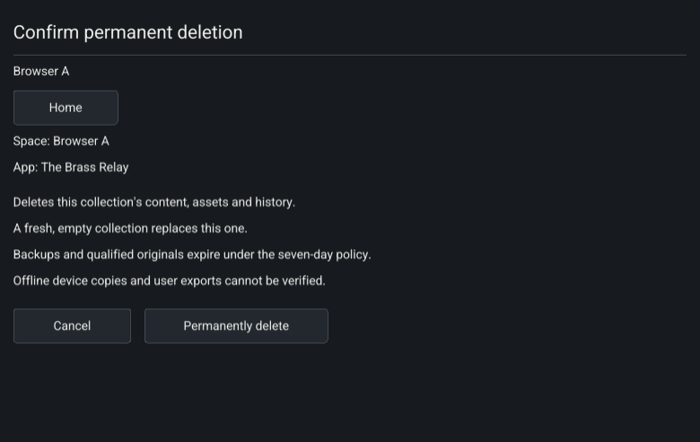

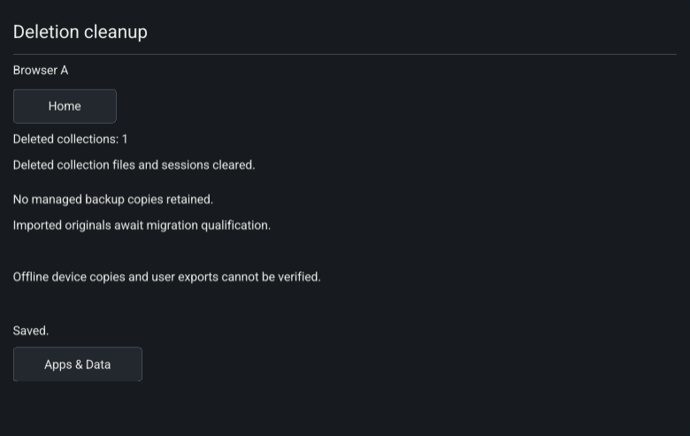

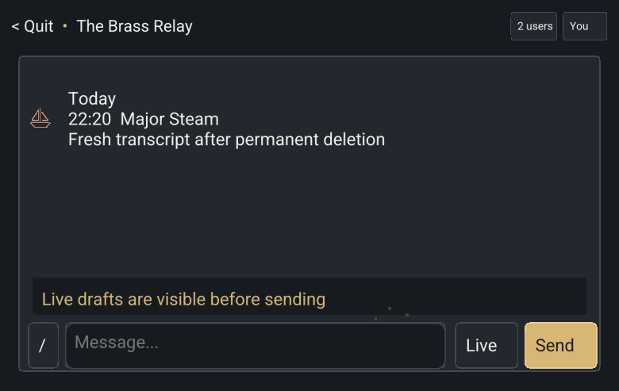

Physical Frame and current ARM qualification remain separate outstanding checks.

## S3 ARMv7 process qualification

The isolated Rust 1.90 builder compiled the clean source
`21c13c78337a4ccdd8cbbc327aac8326ff1e661f` for ARMv7 hard-float, using the configured
`arm-linux-gnueabihf-gcc`/`ar` toolchain. Five unsigned artifacts are retained locally
under `target/dashboard-armv7/checkpoint-21c13c7`:

| Program | SHA-256 |
| --- | --- |
| dashboard-direct | `da0d97c45bdf4a9078197d1233562093b70e4cee57ee9707e29534529b97a70b` |
| dashboard-server | `412bfa6d94bb2ccfba2e622ba07e157833e5a1d0d547212a46f1876489c6cffb` |
| dashboard-monitoring | `7a8562bcd58ab80da79b7db8c40551cd1f668dcfb0bff2edccc23171f4ff1702` |
| session-bootstrap | `5db52cd4f1c8833b6d02840b489eb2e2714487385ed5e5b9f64d40d83bb1cd93` |
| canvas-pack | `22c7ca891e228f5f9cf19994e7bb095195b15e15cc5a3d7edcf528de8d25f8b9` |

A native x86_64 process driver built in the same compatible container runs the
ARM authority through `qemu-arm -L /`. All nineteen process tests pass with two
concurrent tests, including write/delete ordering, disposal-gated reclamation,
chat/subsidiary roots, migration, native-listener identity enforcement and fenced
payload restore. The optional older-writer environment variable was absent in
this ARM run; the actual OTSP4 rollback refusal is separately covered by the
required x86 check 32.

This does not qualify direct display/touch hardware, the live Frame filesystem,
its SSH identity, signed release trust or a physical rollout. S3 software/browser
and emulated-authority checks are complete; physical Frame acceptance is pending.
S4 implementation is the next independent milestone.

## S4 public audiences and comments checkpoint

The public audience implementation is `cecf805`; browser/live-read and disabled
control qualification is `032d001afcd5518e7da3cf04e9cf16dc50a5dd17`.
`bash scripts/check.sh` passed in full (check 36), with the preserved OTSP4 writer
supplied for rollback refusal. Check 33 passed before the browser improvements;
checks 34 and 35 exposed older tests that expected writable controls to remain
present after read-only admission. Those tests now assert absent controls and
replay late input from the former control to verify authority-side rejection.
No failed intermediate run is counted as final qualification.

All 21 authority process tests pass. Public visitors can read, signed-in visitors
can comment only when enabled, and neither permission grants document editing or
moderation. Current closed-only installed code blocks public settings. Sign-out
revokes an old authenticated action grant even when anonymous read remains
available; late old-epoch comments cannot preserve the previous identity.

The [clean-source Chromium run](data/spaces-public-v14.json) repeats the S1–S3
migration, lifecycle, ink and deletion acceptance and adds trusted public sharing
confirmation, anonymous/signed-in read-only views, live public chat windows without
profile creation, signed-in comments, disabled visitor moderation, comment
restriction and closing-Space revocation. It found and corrected a missing live
collection subscription for read-only chat. There are zero runtime exceptions.

- Authority SHA-256: `afe51ae2964725defa74b714337aea937b053da546e4e141c9866ae75d9a806c`.
- WASM SHA-256: `e593896f749bf6429d569f6c3495a13b96c300f3565d3cc008e2602f5fa506e9`.
- Disposable signed browser fixture: `2fb6498dd2fee8735affd1d3280e935b90d7e99721eeed00721632ffe2272b72`.
- State protocol v14; opening release-control v1 unchanged.

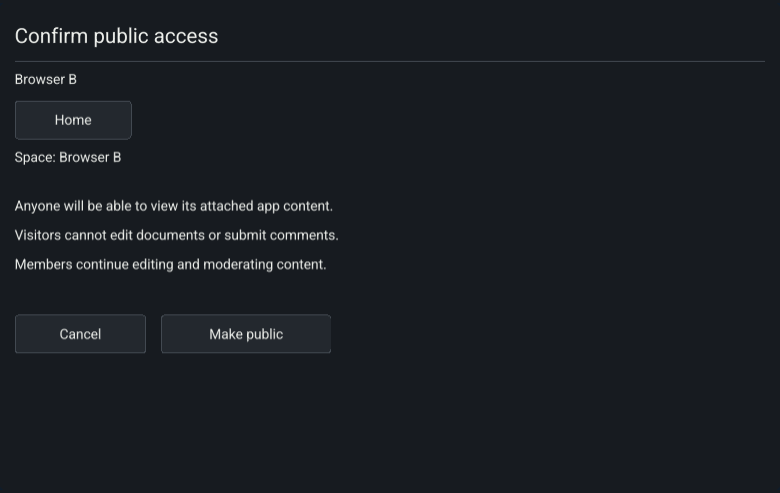

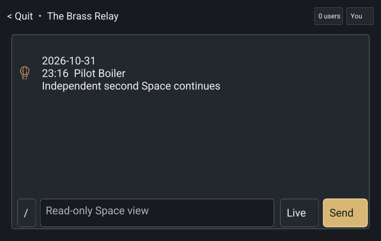

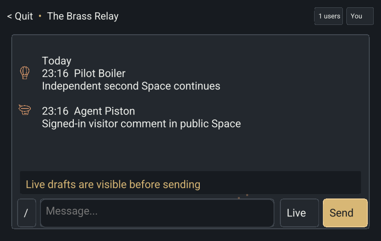

This qualifies public audiences/comments in local software and Chromium. S4
publication with owned assets, current ARM qualification, signed live cutover and
physical Frame acceptance remain outstanding. The disposable fixture does not
establish Frame signing trust or SSH host identity.

## S4 publication and owned-assets backend checkpoint

Source: `3d4579ca5abec84da2d2a404a01673b57a536756`.
`bash scripts/check.sh` passed in full (check 38), including 201 Core library
tests, 68 canvas tests, 19 collection tests, 21 Space tests, 20 trusted-host UI
tests and all 22 authority process tests. The authority SHA-256 is
`60cf7d8b5b0a80da565e58c74a6a4a4fe40b3d36d31e1cf489108af6fd8fd2eb`.
State protocol v15 declares publication, attachment blobs and message moderation;
release-control v1 and registry OTSP5 remain unchanged.

The process probe sends a 200,000-byte binary attachment and publishes one reviewed
confirmed dispatch from a closed Space into a public-comment Space. A source Member
without destination Edit is denied. Anonymous destination reads use the scoped
message reference; a private source revision and removed message cannot retrieve
bytes. Members moderate destination messages; visitors cannot. The copied sender ID
and nonce differ, and public output has no source collection/profile or authority
identity fields. Destination deletion leaves the source readable; a new explicit
publication targets a fresh destination collection. Source deletion and namespace
reclamation leave the independent copy and its bytes intact through restart.

Core tests qualify copied-byte integrity, bounded immutable namespaces, symlink
rejection, interrupted stages, quota across restart, deduplication, stale selection
rejection, missing/corrupt source assets, failed journal outcomes, retained reader
pins, sequence/receipt preservation after moderation and compaction, and confirmed
legacy chat preservation during atomic OTCHAT01-to-OTCHAT02 upgrade. The existing
empty-attachment record shape is retained. Binary blobs round-trip at the 256 KiB
limit without scalar-vector expansion.

Check 37 found that reducing the mixed chat queue to one slot could close a healthy
peer during a short control burst. The final adapter keeps eight slots and holds
byte credits through processing; large binary replies bypass broadcast history.
The full process suite and required check 38 pass with this bounded design.

Both preserved older writers were supplied. OTSP4 control-format rejection remains
covered. The real pre-attachment OTSP5 authority (SHA-256
`afe51ae2964725defa74b714337aea937b053da546e4e141c9866ae75d9a806c`)
rejects a private copy of the OTCHAT02 journal during explicit import without
changing its bytes. This qualifies refusal of the new chat format, not a live
signed Frame rollback.

The trusted publication chooser, browser file controls and current protocol
browser/ARM/physical Frame acceptance remain pending. The earlier Chromium public
sharing evidence is protocol v14 and is not claimed as v15 publication acceptance.

## S4 trusted publication and browser attachment acceptance

Qualified source: `f473efd1d44a0eccc393fe2f25f63364b60ad071` on
`feat/spaces-and-app-data`, with a clean source tree. `bash scripts/check.sh`
passed, including strict Clippy, all workspace tests, 38 JavaScript worker/session
cases, signed bundle checks, 22 real authority/client process cases, and Linux
input fixtures. Core library tests number 207; Canvas 69; Space transitions 22;
trusted Space UI 20. The complete check log SHA-256 is
`1bb26e4bfa2a35a976e41c06c4fa5f85f364c839d4f138eb48104d0b2e083dc6`.
Both preserved pre-OTSP5 and pre-OTCHAT02 authorities were supplied to the process
suite for actual old-writer rejection probes.

The trusted Chat host offers confirmed-dispatch selection, explicit destination
review, publication, attachment upload/download and reviewed moderation. Fixed
host controls work with older Chat descriptions and reject publisher remapping.
Request-correlated download and moderation replies cannot satisfy another
operation. Version-2 mount bindings add an opaque actor context so a different
person, membership interval or attachment cannot inherit previous pending input.
The unchanged release-control opening envelope remains v1; state protocol is v16.

The extended process case rejects a legacy journal-only import containing owned
attachment references, restores verified attachment bytes from a paired backup,
and confirms that a later collection deletion blocks resurrection from that same
backup. Existing confirmed legacy history survives the message-schema and journal
transition; publication/deletion still serialize against current authorization.

The repeatable [Chromium report](data/spaces-publication-2026-11-01.json) passes
with no runtime exceptions. It exercises real file selection and pointer input,
including a portrait publication confirmation, without replacing Worker or DOM
prototypes. A 200,000-byte private attachment survives app removal/reattachment,
then an explicit selected publication copies it into the public Space. An
anonymous reader downloads the public copy and verifies SHA-256
`c7a7d73b68d21102bf7d6d9be27b4106497efc8119224bebfbd26b375541bde7`.
Unselected private dispatches and later private changes do not appear there.
Deleting the source while two private previews are open clears both hosts before
their observed disposal acknowledgements; the destination attachment still
downloads with the same digest afterward. The public reader has no durable chat
profile, and public discovery does not reveal the closed source Space.

Exploratory qualification exposed an initial anonymous-auth response incorrectly
returning an already admitted public app to Home, and command text covering the
file action in a short viewport. The worker now distinguishes initial status from
a signed-in session ending. Dialog layout and pointer regression checks cover six
dispatches/destinations and four attachments in short and portrait views.

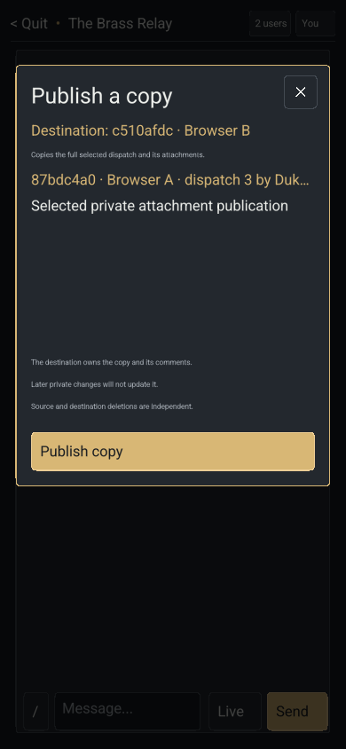

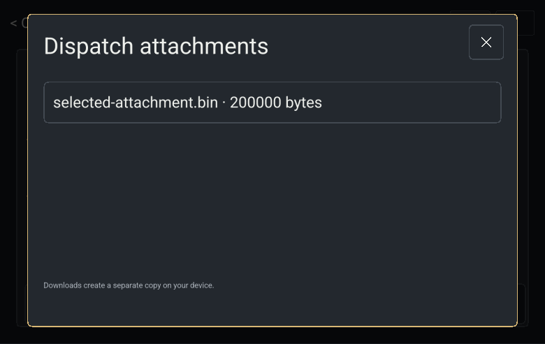

The native authority SHA-256 is
`fa9874dfd8b920a6b84a5c4ba381181027ba0a11ff2387d7a1cce37e125bf3b5`;
Wasm is `227f4e6f8a3e801c91c8480699693cd1c5373e18b446eab29b13067b0b5479b2`.
The disposable signed browser fixture is
`4e4d755efb6fdab0782a5521981358486273f96de94388d26d658eac47dcb092`;
it contains no native executable and was not deployed. Native file picking and
downloading are not offered; native hosts list attachments and can publish their
owned bytes. Physical Frame identity/migration, signed activation, display/touch
acceptance and a qualified rollback remain required. No final-review PR has been
opened.

## S4 ARM authority and final fixture qualification

The clean `f473efd1d44a0eccc393fe2f25f63364b60ad071` runtime archive builds all ARMv7 release targets using
Rust 1.90.0 with explicit ARM CC/AR and linker settings. ELF inspection confirms
32-bit ARM EABI5 executables. The [machine-readable report](data/spaces-publication-arm-emulated-2026-11-01.json)
records the source archive, six unsigned artifact digests, toolchain, emulator and
commands. The authority SHA-256 is `31c357fc34be3dc54c8e4b621582686538ae1dbbfeae0a5e393de9484e893d82`;
the native direct host is `276040309751b6b48f44af903f0aacb03c49cd6a26ccc27bfe95f2be4f3d4e05`.
These artifacts are preserved locally under `target/dashboard-armv7/checkpoint-f473efd`.

All 22 authority/client process cases pass against the ARM authority under QEMU
in 24.49 seconds with two test threads. This includes selected publication,
owned attachment retrieval, public restrictions, source deletion independence,
paired backup recovery, restore after deletion, confirmed legacy migration,
explicit Frame identity and active revocation. The process driver runs on x86_64;
its authority subprocesses execute real ARM code through `qemu-arm -L /`.
A separate publication case supplies the preserved `21c13c7` ARM authority as the
actual older chat writer. It rejects a copied `OTCHAT02` journal without changing
its bytes. This is a format refusal probe, not a physical rollback acceptance.

The first ARM attempt correctly rejected new fixture manifests and copied journals
whose permissions depended on the ambient umask. The fixtures now use the existing
private-file creation pattern for both kinds of input. This reaches the intended
legacy owned-asset rejection and actual old-writer probe without weakening any
permission checks. Fixture-only source `2114db2945692040d91c9f1c010911f3bb077843` passes the full required
`bash scripts/check.sh` suite, including all 22 native process cases with both
preserved native older writers. That final check log SHA-256 is
`1393b1239995962950adf7b889f24ce423b4d49b1988057b55f518cc54c1fc5b`. Runtime and browser code are unchanged
from the clean Chromium-qualified `f473efd` source above.

The native host was compiled for ARM; it was not exercised against physical KMS,
touch input or Frame's installed libraries. No unsigned binary or disposable
browser release was activated on Frame. Production cutover still requires the
pinned SSH host key and existing Mac builder/signer access, followed by explicit
identity/migration provisioning, signed verification and physical acceptance with
a qualified rollback. The goal remains open for those steps; no progress Issue or
PR is used to track them.
