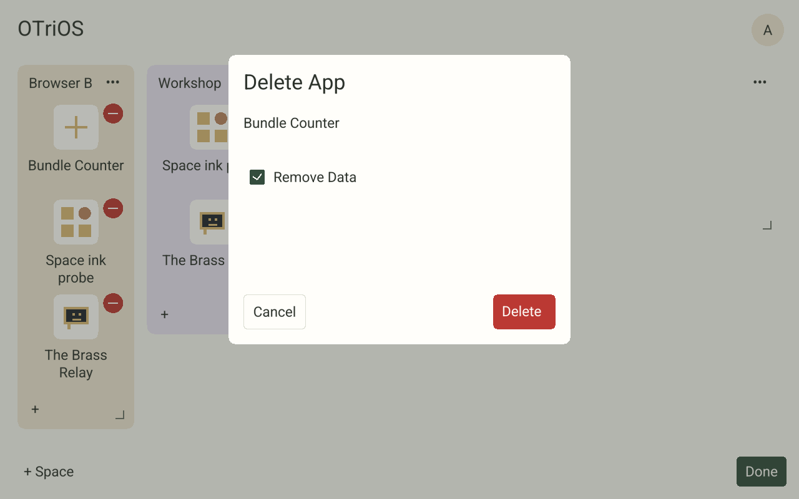
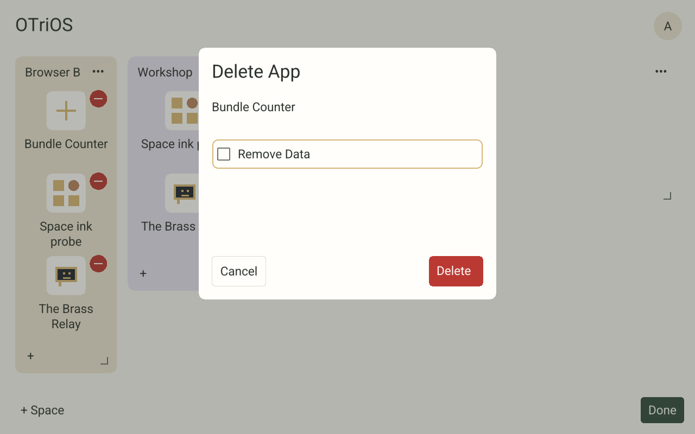

<!-- SPDX-License-Identifier: Apache-2.0 -->
# RFC 0028 portable transfers — 2026-11-02

Status: **complete, validated and deployed**. This records one continuing
qualification campaign for the combined [RFC 0028](../rfcs/0028-spaces-map-sharing-and-portable-data.md)
scope. The [aggregate record](data/spaces-transfers-2026-11-02/acceptance.json)
contains the requirement audit and technical results, without private inventories.

The combined campaign implementation is pushed at `5a5a86bbdccff490734c15d26f1838ad9867ba26` on
`feat/spaces-portable-transfers`. It preserves the retained-data/admin-moves
histories and includes current `main`. Before cutover, authority and native ran
`50e8bc2e1ece14aa9feafc366df095ea475c93e991c2be29cf05d19db7a28a0c`
with state v19. The combined campaign completed on signed release
`ea25d0ba1e159c71762f77050da9063d7e786e76c13a79825c77fa92cd24c0e2`,
using state v20, Spaces envelope v5, registry OTSP9 and opening control v1.

## Implementation and local evidence

The [transfer contract](../TRANSFERS.md) records exact framing, limits, authorization
and fixed fixture bytes. The shared panels now connect to browser file/URL intake,
public code publication, complete confirmed exports and reviewed replacement.
Frame has an asynchronous private Transfers-folder adapter with opaque, metadata-bound
file selection, bounded streaming, atomic export completion and account cancellation.
Installation and replacement still commit only through the existing Spaces channel.

`TMPDIR=/private/tmp bash scripts/check.sh` exited **0** on the integrated candidate.
The initial log is `target/rfc0028-check-final.log`; the final padding-fix run
also exited 0 in `target/rfc0028-padding-check.log`. Rust 1.90.0,
locked offline dependencies, isolated `CARGO_TARGET_DIR` and two test threads were
used. The gate includes strict workspace Clippy, Rust/Python/Node checks, signed
release installation/recovery and a separate real-authority process invocation.
The ordinary workspace invocation's process-test scaffolds are not counted as
process acceptance: the explicit `OTRIOS_SPACES_SERVER=...` invocation ran and
passed all **32** cases against the newly built server.

Relevant focused suites also pass:

- 242 core library cases, including portable fields/signals, complete chat history,
  durable import decisions, replacement recovery and OTSP8-to-OTSP9 migration.
- 38 shared host UI cases, including explicit import/replacement/publication
  confirmation, exact dataset targeting, cancelled/stale reviews and role loss.
- 18 native owner cases, including five transfer adapter cases covering private
  regular files, single-use picker IDs, changed files, quota, streaming round trips,
  malformed response cleanup and cancellation during stalled socket input.
- 14 transfer cases and four fixed portable data fixture cases. The independent
  Python oracle checks ZIP/checkpoint/causal framing and SHA-256 closure; Rust
  checks canonical FlexBuffers bytes, typed values, every reopened root, complete
  historical records and owned assets. This does not claim a second independent
  FlexBuffers implementation.
- Eight browser transfer adapter cases and 15 browser worker cases. A real browser
  exposed an incorrect `fetch` receiver that the original mocks did not catch;
  the adapter now binds it to the browser global and has a regression case.

The ARMv7 direct host/authority build passes with the pinned Docker toolchain.
Its source archive now includes `LICENSES`, required by the bundle tool, and omits
macOS extended attributes. The release Wasm build also passes. These platform
checks precede the final canonical signed build; final acceptance must identify
the exact signed artifact hashes. No dependencies were added in this continuation;
the native adapter enables the already locked randomness and CA-root dependencies.

## Isolated browser acceptance

The updated `qualify-spaces-browser.py` / `test-spaces-map-browser.mjs` run exited
**0** against disposable synthetic state. The driver waits for a stable rendered
epoch before clicking and uses actual browser keyboard input for pickup, rather
than assuming that an old accessible control still belongs to the current epoch.

The run verifies the common map, retained-data recovery/deletion, scoped movement
with explicit public exposure, and the actual portable data path:

1. Download a complete `.otdata` file through the browser host adapter.
2. Invoke the real file input and select that downloaded file for another Closed
   Space using the same installed app/schema.
3. Observe the review with its original target CID still active.
4. Confirm replacement, observe a fresh CID and verify that the exact outgoing
   CID is retained with `BeforeReplacement` provenance.
5. Reopen the imported app and verify the exported value, then remove only the
   disposable acceptance scope. Original fixture app CIDs remain unchanged.

The local records are `target/rfc0028-browser/{map,retained,moves,portable-data}-acceptance.json`,
with synthetic export/review/backup screenshots in that directory. The run reports
no runtime exceptions. This fixture's counter value is zero; nondefault values,
complete histories beyond the UI window and assets are established by the fixed
fixture and real-process tests, not inferred from that browser value.

The first development artifacts came from a dirty checkout. The full driver and
populated-map variant subsequently passed again using canonical Mac binaries and
the exact signed candidate Wasm (`17004c8f…`). Their synthetic catalog/release
remains separate from live production state. They do not establish Safari or
physical Frame input; the latter is covered by the deployed evidence below.

The thin `transfer_ui_probe` helper derives private on-device control coordinates
from negotiated discovery, the matching catalog and a local review recipe. It
performs no network I/O and rejects a recipe that queues management or changes
scope; a final confirmation is a coordinate query only. Export, replacement and
app-review recipes were checked against a disposable authority's real discovery,
and attempted import confirmation was rejected by the guard. Strict example
Clippy/build checks pass. These checks qualify coordinate generation only. Physical
input, actual host I/O and independently observed authority decisions must still
establish the on-device transfer results. The canonical ARM build includes this
helper and the existing authenticated management probe for that work.

## Signed deployment, migration and recovery

The existing Mac workflow built and verified candidate A:
`6fd416fb81ec6013eb493bf6575ea8729675ae867727ddecee0663c0a5cb141b`.
The exact Wasm SHA-256 is
`17004c8f0db653131b11f4bba522e750d5d6ac757291b318b5154096f5090f81`;
the native ARM SHA-256 is
`4095e8ed392a2d09a6ff1384986cb38fae0342e8ceb027e85a25ee8285378ea5`.
That frozen implementation qualified before the later Close-padding correction below.
The exact-Wasm browser driver
and populated 14-app/four-Space variant both passed on committed source.

`backup-frame-release.py --tag 2026-11-02-spaces-portable-transfers` verified
265 files in a paired private Frame/Mac pre-cutover kit and restored services.
Raw metadata, inventories and credentials remain private. Before live activation,
the actual unprivileged ARM server recovered a disposable copy in a private
mount namespace at the original canonical storage path. This preserved pairing
invariants without weakening them. OTSP8-to-OTSP9 migration preserved metadata and
all 56 copied payload files; v20 reopened successfully. The obsolete writer
remained running but returned 503 for state/health with invalid storage. The check was corrected to assert this fail-closed behavior instead of
assuming process exit. The clone was removed and live state stayed unchanged.

Pinned-SSH deployment activated A before sending upgrade events. The live audit
then confirmed unchanged original Space metadata and 54 non-collector payload
files, device identity, credentials, calibration and collector binding. Primary
and latest registry use OTSP9. An anonymous browser tab opened on v19 upgraded
to A automatically, stayed connected, and exposed only public controls.

Aaron explicitly approved host-operator rights for the two existing human/Frame
identities after automatic approval review requested that specific authorization.
Actual IDs were resolved privately. No credentials or memberships were added or
changed. Only the configured operator list changed, with its original privately
backed up.

## Deployed transfer acceptance and compatible rollback

The physical Frame exercised these operations in one new Closed fixture Space:

1. Export through the shared UI and native adapter to a private 0600 `.otdata`
   file. Metadata generation remained unchanged.
2. Select that file through the actual native picker, observe review without a
   mutation, then explicitly confirm replacement. A fresh CID became active and
   the exact outgoing CID remained a BeforeReplacement backup. The complete
   1,235-byte archive re-export matched byte-for-byte. The first input
   sequence missed its target; resetting to a known home state and using paced
   input with readiness checks resolved the driver sequencing issue. Direct real-authority intake
   independently qualified the file and its temporary review was cancelled.
3. Receive a distinct standalone `transfer-counter` SDK payload. Review/cancel
   did not install code. The actual native file picker and explicit confirmation
   queued its durable import. `process-app-imports.py` used the existing Mac-only
   signer bridge to activate app-only release B:
   `d0fd9ecfb6327910171ebdde8f8b2c448959c6daea8a81fb1e67f370b65699b3`.
   Qualified host binaries and original data stayed unchanged.
4. Publish that verified SDK code through the native Share App / Publish App
   controls. An anonymous ordinary browser showed its title, Download App, the
   code-only explanation, project source and hosting guide. HTTPS download
   unpacked and verified against the independent pinned publisher with exact
   bundle digest `e54e2c9ab7bdbca46e9f32bafbb655391ca6c7ca9ea9e87393250a5108323365`.
   Actual authority HTTPS URL intake returned the same installed digest; its
   review was cancelled without a metadata change. This URL check used the real
   server fetcher; it is not a claim of typing the URL on the physical keyboard.

Input was synthetic evdev through the actual calibrated physical-device reader,
not observed human finger input. No Frame pixels or private inventories were
exported. Nondefault fields, long histories, historical profiles and owned assets
are established by fixed-fixture/process tests, not inferred from this small
live dataset. The production-origin host checker also passed all 180 public
signed-code, negotiation and isolation checks; production password login was
not tested.

Cloudflare returned error 1010 to the diagnostic's default Python User-Agent.
The ordinary browser and product URL fetcher succeeded. Giving the diagnostic
an identifying application User-Agent completed its independent download check;
no routing/security policy changed. See [Cloudflare's documented cause](https://developers.cloudflare.com/support/troubleshooting/http-status-codes/cloudflare-1xxx-errors/error-1010/).

A new replacement was confirmed under B, then verified code-only rollback B→A
and reactivation A→B both preserved its latest binding, exact metadata and all
60 non-collector payload files. Re-export stayed byte-identical in both releases.
No data snapshot was restored. A separately verified v20 fallback, matching
server and control tools remain in the private rollback kit independently of
cache pruning. The older v19 release is not a compatible current-data rollback.

The fixture Space was archived with its data removed through the authority's
normal flow; its three known Transfers files were removed. Removing only the
temporary SDK app through `install-app.py` produced cleanup app-only release C:
`057aca96209224b3249ef9895a390c456e6a26cb466861e0552d3db41665223c`.
All A/B/C Wasm and native hashes are identical. The explicitly published SDK
code object remains independent of installed code and Space deletion; its exact
verified archive is the one accounted-for additional code object, with no data.

Post-cleanup preservation rechecks confirm unchanged original metadata and relative
order, all 54 original non-collector files, credentials, memberships, identity,
calibration and collector binding. Only the added fixture appears archived.
C's full signed closure verifies; Mac/current/staging, authority and native
last-good agree. A cold native boot runs C itself, confirmed and idle, with
healthy authority, native and tunnel services and successful monitoring. The
existing Mac watcher/signing bridge is running on exact pushed source `9a61137…`
with its source inbox fingerprint matching the frozen build. Previous controls
and launch configuration remain private in the rollback kit.

## Final Safari qualification and Close padding

After Safari became accessible, Safari 27.0.1 signed into the disposable fixture
on its first submitted attempt and rendered 14 apps across four Spaces. Through
actual authored controls it opened Bundle Counter, changed its value from 0 to 1,
returned through the breadcrumb, downloaded `.otdata`, selected that exact file
through Safari's native file chooser, reviewed and cancelled without changing
metadata, then confirmed replacement. Authority reads verified one generation
advance, a fresh CID, the exact outgoing backup and unchanged other bindings.
The complete 1,963-byte re-export matched SHA-256
`79c7b8e9e4d22cd518ffe5dd8480c7c48bb0805610bbf01f4f09147907fcf62d`.
The reopened app displayed 1. Both downloaded files were preserved in the ignored
fixture output; the temporary server and agent-created Safari tabs were closed.

The user observed that the transfer Close button sat too close to the right
edge. The shared footer had assumed a 100-pixel button while transfers use 120.
It now mirrors the authored content inset using the actual width. The existing
export/replacement UI case checks alignment against the content's right edge.
The focused case and the full `bash scripts/check.sh` both passed on `5a5a86b`,
including all 32 real-authority cases and signed installer/recovery checks.

The final canonical Mac build signed release D:
`ea25d0ba1e159c71762f77050da9063d7e786e76c13a79825c77fa92cd24c0e2`.
Its frozen source fingerprint is
`75b7fb32da92fcf9222a9540e78c710dd22054fc20852a1b22c0318562f6cfe3`.
Wasm SHA-256 is
`632a7965c51a22c1320bb78071b85883bcbe9b0adf0672cc75ca7b1113f27947`;
native ARM SHA-256 is
`bd425e9d28fbcfba81a8f9dbfc5b9107c2d615390fc732226ddc021993b4a526`.
Every signed app byte and the catalog are identical to C. Protocol/storage code
is unchanged; state v20, Spaces v5 and OTSP9 remain current. Existing migration,
rollback and codec evidence applies. The exact new Wasm with the newly built
authority passed the integrated browser driver again, including real download,
picker, fresh replacement, retained backup and zero runtime exceptions.

Safari's existing fixture received the final Wasm by signed activation and kept
its confirmed value 1. The corrected export and replacement footers visibly
share the content inset. A second full Safari download/picker/review/confirmation
on that exact Wasm again advanced generation once, retained every previous backup,
created a fresh CID and reproduced the complete archive. The reopened value was 1.
The fixture authority retained its compatible backend during this UI-only refresh;
the integrated driver separately exercised the newly built authority. Safari
also opened the deployed D public map, entered the read-only public app and
returned via its breadcrumb; anonymous Edit remained unavailable. Its ordinary
public share page showed the canonical title, download, instructions and project
links. Production password login was not tested.

The compatible C pre-padding backup verified 269 files in the private paired kit
`2026-11-02-spaces-transfer-padding`. Deployment activated D through pinned SSH.
A matching ARM coordinate helper drove the actual calibrated reader at a point
six logical pixels inside the new Close button's left edge, outside its former
misplaced bounds. A second read-only export proved the first Close returned to
settings. Both private temporary exports were removed; metadata and calibration
stayed unchanged. This remains synthetic evdev input, not human-finger observation.

The final public-host probe passed **173** checks on D; the earlier **180** checks
were on the temporary app-install release. Signed closure and private/admin
isolation pass. Final audits preserve all original Space metadata and all 54
original non-collector files, plus exact current metadata and 55 current
non-collector files including the separately published SDK code object. Credentials,
identity, calibration and collector binding are unchanged by the padding rollout.
No data snapshot was restored. Mac/current/staging, authority and native last-good
match D, and the running native executable itself is D, confirmed and idle.
Monitoring succeeded. The existing Mac signer watcher is running on exact pushed
source `5a5a86b`, with its source inbox matching the frozen build. Prior controls
and the verified compatible fallback remain private in the rollback kits.

All RFC requirements have corresponding evidence in the aggregate completion
audit. Final documentation-only edits preserve the implementation fingerprint.
These UI/process checks do not establish Linux shared-memory IPC.

## Remove Data checkbox follow-up

A reported Delete App control appeared unable to toggle. Its local action already
changed the deletion choice, but both Unicode circle indicators fell back to the
same missing glyph. Its semantic state also remained unchecked and the browser
presented it as an ordinary button. Delete App and Delete Space now share a drawn
24-pixel checkbox, with a clear empty/checked appearance, the real checked state
and the browser checkbox role. It remains off by default; toggling stages a local
choice, Cancel resets it, and only Delete sends the reviewed management command.

The [follow-up evidence](data/spaces-transfers-2026-11-02/remove-data-checkbox.json)
records signed release `698d1693021dfdadf87ac4bed941e9b2ddcbd763c7b1bf195f8a4db3130c2ba4`, qualified source
`dff9602401da49669239ed5bd245af627f14295f`, full repository checks, the exact-Wasm
browser run, physical Frame acceptance and preservation audit. The focused
regression covers box/label pointer hits and accessible activation in both deletion
panels. The full check passed all 39 shared UI and 32 real-authority process cases.
A subsequent test-only commit waits for the dialog before its initial assertion;
the canonical builds before and after that change produced identical signed bytes.

Real Chromium mouse input checked the option, Space unchecked it, and inspected
rendered images show both states. The integrated driver also passed default keep,
cancel/reset, exact restore and checked removal using disposable data. On the
physical Frame, two calibrated evdev taps each caused a fresh UI epoch; Cancel
and Done returned to the map without changing metadata. This is synthetic device
input, not observed human finger input; no Frame pixels were exported.

The paired private backup verified 273 files. All 57 current non-collector payload
files, Space metadata, credentials, identity, calibration and collector binding
remain unchanged. All signed app and catalog bytes are identical to the preceding
release. The public host probe passed 173 checks; native/authority release and
readiness match, and monitoring succeeded. State v20, Spaces v5, OTSP9 and opening
control v1 are unchanged. Existing compatible rollback/migration evidence applies;
no data snapshot was restored. Safari acceptance above describes the combined
campaign, while this follow-up's real browser acceptance used Chromium.
