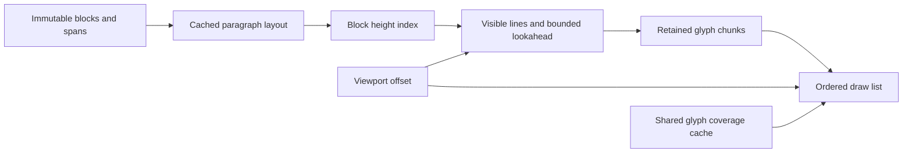

# RFC 0020: Reflowed documents with retained text chunks

Status: proposed plan, requested 2026-10-27. No document engine or performance
claim is introduced by this RFC. Native is the performance target; the shared
Rust layout and a scalar browser adapter belong in the same first delivery.
Extends [retained text viewports](0017-retained-text-viewports.md) and the
[measured renderer selection](0019-native-fixed-simd-pipeline.md).

## Outcome and present limits

Scroll a long, wrapped document by moving its viewport over retained glyph
buffers. Lay out and upload incoming content in bounded chunks ahead of the
viewport. Edits and changes in width update affected layout; they do not turn
every scroll frame into a complete document rebuild. Preserve the existing
momentum, immediate reversal at hard stops, ancestor clipping and actual-frame
counter. Ordinary wrapped text scrolls vertically; unwrapped code can scroll
horizontally as well.

The current Layout Lab demo positions 64 short text rows; it does not perform
document wrapping. `TextPresentation` clones/normalizes a scene, retains one
mesh, and rebuilds it when its geometry key changes. Scene admission limits the
tree to 512 nodes, each text value to 257 UTF-8 bytes, and frame components to
±8192. One glyph buffer supports 16,384 quads through 16-bit indices; larger
scenes return to the visible-mesh path, whose renderer still has that buffer
limit. These are unsuitable document storage or overflow policies.

Use one bounded document viewport in the scene, backed by a separately admitted
document. Do not represent the whole document as thousands of scene nodes,
raise every existing UI limit, or silently truncate text at the mesh limit.
Keep the small input-field path and its existing admission rules.

## Model and cache boundaries

Keep these concepts separate:

| Object | Identity and contents | Invalidation |
| --- | --- | --- |
| Document source | Stable block IDs, immutable text revisions and block-local UTF-8 ranges; ordered paragraphs with span references | Text or structure edit; immutable bytes shared across snapshots |
| Measured runs | Glyph IDs, advances, offsets, cluster ranges and metric/font dependencies, in bounded pages | Source or metric/font/shaping changes; reuse across widths only where the adapter guarantees validity |
| Paragraph layout | Source ranges, visual lines, baselines, run references and ink bounds | Paragraph content, available width, metric styles, resolved font dependencies or layout configuration |
| Height index | Ordered blocks with subtree heights and source lengths; exact or estimated height tagged with its layout key | A block height or sequence change; logarithmic lookup/update without visiting later text |
| Render chunk | Bounded complete lines or line fragments, local float32 glyph data, source mapping, bounds and independent generation | Only its changed layout/paint dependencies; scrolling changes its draw transform/range |
| Coverage entry | Font resource/generation, glyph, effective sampling size and shader generation | Font/sampling/context changes or eviction; tint and viewport position excluded |

Use per-block revisions and dependency keys; a global document revision must
not invalidate every paragraph. Width keys preserve the actual logical width
used for line breaking. DPR affects sampling, not wrapping unless logical width
also changes. Paint changes have their own generation. Keep source/layout data
independent of GPU UVs and coverage-cache generations.

The first reader can reuse measured advances during a width change, then redo
line breaking and packing. Do not repeat font lookup just because wrapping
changed. Future line-dependent shaping must declare the extra context it needs;
width-independent reuse cannot override a shaper's correctness requirements.
Make line-break decisions from canonical metrics with wide scalar accumulation,
rounding only at the presentation boundary. SIMD packing must not reassociate
the arithmetic that decides which word fits on a line.

Paragraphs are layout units, not GPU allocation units. Start with a target of
1,024 drawable glyphs per chunk and a hard cap of 2,048, also bounded by bytes.
Prefer complete lines. Split an unusually long line at a safe cluster boundary,
with its baseline and source mapping preserved. A large paragraph spans many
chunks. Small paragraphs can share backing allocation while retaining their
own ranges and transforms. Avoid regrouping all later chunks after one edit.
Each chunk fits the existing 16-bit index path; reuse the quad index pattern.

The paragraph cache itself must be paged. Keep its summary/height and sparse
source/line checkpoints, with bounded resident pages of line and glyph results.
Measuring an offscreen paragraph need not retain all its glyphs. A single huge
paragraph must not bypass the working-set cap merely because it is one block.
Resume from a checkpoint with the required break/shaping context; a future
shaper that cannot safely resume needs bounded context admission or a different
adapter, not arbitrary cuts through contextual shaping.

Document heights and scroll origins use f64 CPU accumulation. Compute the
difference between a block origin and viewport origin before converting to
bounded local f32 GPU coordinates. Retain f32 glyph batches and the selected
GL_FLOAT path. This avoids uploading huge document coordinates and preserves
small scroll deltas far into a document without reviving the fixed-point pilot.

Initially admit at most 16 MiB of UTF-8 and 65,536 blocks, with a separate bound
of 8 MiB on source/index metadata. Proposed document working-set caps are 16 MiB
CPU and 8 MiB GPU, excluding admitted source/index bytes, shared fonts and the
separately bounded coverage atlas. Count capacities, staging, queued work, pinned snapshots
and old/new layout epochs against these caps. A screen that cannot fit the
declared limits fails admission explicitly. Final limits must be validated on
the frame before implementation sign-off; document length cannot expand the
resident glyph/mesh budget.

## Scrolling, work scheduling and reflow

1. Resolve viewport y through the height index, then find intersecting visual
   lines and chunks. Reject whole offscreen blocks/chunks before glyph culling.
   Use ordered line/range lookup and conservative ink bounds; do not linearly
   scan all glyphs or assume future bidirectional text has logical x ordering.
2. Reuse unchanged buffers and update only visible chunk transforms, ranges and
   the projected scissor. A warm scroll inside the resident window generates
   no glyphs and uploads no glyph geometry. Do not clone the document, normalize
   a full scene tree, or concatenate resident chunks into a replacement mesh.
3. Keep roughly one viewport behind and two ahead initially. Adjust lookahead
   for velocity and measured generation latency within the byte cap. Retain a
   small reverse-direction reserve and eviction hysteresis to prevent boundary
   oscillation from repeatedly regenerating chunks.
4. Prioritize visible layout, incoming chunks, then distant height measurement.
   Shape/measure farther ahead than GPU materialization. Cache coverage only for
   visible or imminent chunks; never rasterize the whole document as prefetch.
   Native layout runs in bounded worker jobs; browser layout yields between
   worker tasks so pointer/network events can run. GPU work stays on its owner.
5. Make decoding, breaking, packing and upload work resumable and byte-bounded.
   Start with a 2 ms CPU scheduling budget per turn and at most 512 KiB of new
   geometry upload per frame, then profile. A giant paragraph must not become
   one uninterruptible job. Cancel obsolete work by mount and layout epoch.
   Coalesce resize requests and keep queues bounded when consumers fall behind.

Keep a logical scroll anchor: block ID, source cluster position, affinity and
its viewport-relative y. When layout above it changes, update the height index
and compensate the scroll offset so the same text stays in place. A content
edit supplies a revision mapping for that anchor; if its text is deleted, use
the nearest surviving boundary. Do not retain an old absolute pixel offset as
the definition of the user's reading position.

A width/font/metric change starts a new layout epoch. Reflow the anchored visible
window first, then nearby content and background heights. Publish a coherent
visible window for one width/epoch before replacing the previous one. Offscreen
old-width heights may be estimates, but old-width lines must not appear in the
new visible layout. Within an unchanged width, edits reflow the affected
paragraph and any explicit layout dependencies. Reuse a suffix only when source
position, line-breaking/shaping carry state and metric dependencies agree.
Later block origins change through the index, without moving their vertices.

Cold opening, a distant jump and width changes may leave unmeasured heights.
Mark total extent and scrollbar position as approximate until measurement is
complete; do not label an estimated bound as the end of the text. Use the
logical anchor to resolve jumps, and lay out the terminal block before declaring
an end stop at its actual last line. An End action targets that logical boundary,
not the estimated total; an exact numeric document extent requires measuring all
preceding heights. Dragging into unprepared content prioritizes that work and
can show an explicit loading region; do not silently omit text or display a
different source range. Normal continuous scrolling must prefetch fast enough
to avoid such regions in the qualified workload. No bounce past known ends.

## Host buffers, publication and resource lifetime

Introduce a bounded chunk resource cache and an ordered draw list on both
hosts. Native currently has three fixed scene/text slots; those are host layers,
not a document chunk cache. Browser layers can hold separate buffers, but
`SceneRenderer.prepare` currently rebuilds every supplied layer when any layer
is dirty. Refactor preparation so a changed chunk does not reupload its neighbors.
This is part of the first delivery, not a later optimization.

Publish upserts/retirements for independently versioned chunks, followed by a
frame that references exact chunk versions and a layout/mount epoch. Preserve
document/background/decoration/selection painter order; batching must not sort
arbitrary translucent runs by font or style. Clip a document through the normal
ancestor chain, including native rotation and browser DPR.

Native snapshots share immutable chunk buffers through Arc ownership. The
display thread alone creates and retires GPU resources. Browser transfers only
changed chunk payloads; unchanged frames carry the small draw list and viewport
state. Acknowledged resource versions survive viewport-frame coalescing. Never
drop an upload still referenced by the latest frame, draw before its dependencies
are admitted, or reuse a retired numeric handle with a stale generation. Bound
in-flight frames and bytes; a slow renderer applies backpressure or drops
superseded work without mutating held snapshots. Context loss requests replay
of the current resident resources, not reserialization of the entire document.

Keep the coverage atlas shared across chunks. Pin dependencies of active frames
and avoid a reset/re-rasterization cycle on every chunk arrival. Respect the
existing bounded storage, adaptive alpha policy and ordered analytic fallback.
If a global atlas reset remains necessary, invalidate dependent UV buffers
explicitly and repair visible chunks first; stale UVs are never valid cached
geometry. Count cache repairs and fallback cost separately from warm scrolling.
Do not hide extra atlas generations outside the memory budget.

Document resources must use the existing admitted resource/state ownership path.
A runtime handle is not a persistent content identity or capability. Navigation,
privacy clearing and release replacement cancel queued jobs and release all
document-specific CPU/GPU state. Implementation belongs in LGPL runtime paths;
public schemas and thin host adapters retain their existing license boundary.
No new dependency or unsafe boundary is approved by this plan.

## Rich text without changing the scrolling design

Represent text as styled spans from the outset, with one default span for plain
text. Metric styles include font resource, size, shaping features and paragraph
metrics; paint styles include tint, highlight and decorations. A tint/link-state
change updates paint data or affected chunk colors, without reshaping or
reflowing. A metric change invalidates the paragraph layout. Selection and caret
are separate overlays driven by source/cluster mapping; dragging to preview
text does not automatically recover the caret.

Define a shaping boundary that returns explicit glyph IDs, advances, offsets
and source-cluster ranges. Rendering chunks must not become shaping boundaries:
context can span paint changes and chunk edges. Line breaking and grapheme
segmentation follow separately pinned policies ([UAX #14][uax14] and
[UAX #29][uax29]); bidirectional layout needs its own paragraph/line processing
([UAX #9][uax9]). Validate UTF-8 ranges without normalizing or rewriting source.

The first reader uses the existing font's declared left-to-right prototype
subset and explicit missing-glyph behavior. It must not claim general Unicode
typography: the current 213-glyph Roboto packet and scalar-to-glyph mapping do
not supply complex shaping, fallback stacks or full-script coverage. Choose and
benchmark a safe shaping/segmentation implementation and its resource needs
before expanding that support. Preserve grapheme boundaries and mapping even
where a missing cluster is displayed as a replacement marker.

Multiple faces will need admitted per-font outline/shaping resources and
font-aware coverage keys. Calling today's global `set_font` on every styled run
would replace font textures and clear the cache; it is not a rich-text solution.
Keep required faces resident under an explicit budget, bind them for ordered
analytic fallback, and invalidate only their dependents where possible. Font
resources must include the glyphs and shaping tables required by the selected
shaper; the current outline packet alone is insufficient for that promise.
Headings, links, emphasis, code and decorations can use the same block/span/
chunk architecture. Tables, floating media, pagination and a full editing UI
remain outside these two deliveries.

## Two deliveries and their acceptance

| Delivery | Complete result |
| --- | --- |
| 1. Long reflowed document reader | Shared Rust block layout, height/anchor index, bounded chunk window and scheduling; native and scalar WebGL chunk resources/deltas; wrapping and resize; a Layout Lab long-document momentum demo. Profile continuous chunk generation and include a float SIMD kernel only if it improves complete work. |
| 2. Incremental styled documents | Local paragraph/paint invalidation, edit-to-anchor mapping, mixed metric/paint spans, selection/hit mapping and the admitted multi-font/shaping foundation. Qualify rich fixtures and any reused Wasm SIMD path; retain scalar compatibility. |

Build a full-layout scalar reference for small documents using the same declared
typography policy and existing glyph renderer. Pin independent expected line
break/cluster cases; compare chunked output across every boundary and edit.
Preserve existing captures. New layout behavior needs its own reference; the
fixed-row demo alone cannot qualify wrapping.

Run 100 KiB, 1 MiB and 10 MiB fixtures with varied paragraph lengths, including
one very long paragraph, long unbreakable tokens, whitespace/newline boundaries,
negative bearings, missing clusters and alternating styles. Test continuous
forward/reverse momentum, boundary oscillation, rapid jumps, append/edit/delete
above and inside the viewport, font/width changes, stale jobs, context loss,
atlas exhaustion and slow consumers. Include an extent beyond f32's consecutive
integer range to verify local rebasing and anchor stability.

Proposed performance gates for the declared corpus and unchanged text density:

- At least 30 kernel-presented fps in each of three 30-second native runs,
  including arrival of previously unmeshed chunks, using the existing calibrated
  RGB565 frame. Sweep to the current 4,000 logical px/s gesture limit and reverse.
  Report cold opening/jumps separately, p50/p95/p99 intervals, missed vblanks,
  blank/loading regions and stalls. Do not average only warm interior frames.
- Warm scrolling generates/uploads zero glyph geometry; document viewport work
  targets p95 ≤1 ms. Generation jobs target the 2 ms turn budget, and sustained
  layout/packing throughput must exceed the measured maximum-rate viewport
  consumption by at least 2×. Report source bytes, clusters, glyphs and lines per
  second, first visible page latency, and visible/complete reflow latency.
- Resident layout/mesh memory plateaus under the declared caps as document size
  grows; source/index memory is reported separately. Track dirty chunks, bytes
  copied/uploaded, pinned generations, cache repairs, queue depth and evictions.
  Owned buffer capacities and declared GPU bytes are not driver RSS measurements.
- Native rotations 0/90 and real browser DPR 1/2/3.2 pass reference comparisons
  with the existing maximum channel-error gate of eight, foreground/edge stats
  and saved images. Require exact structural/cluster/line results; prefer pixel
  identity and investigate any difference rather than loosening thresholds.
- For SIMD, profile measurement/lookup, breaking/shaping, quad generation,
  packing/copying and host upload separately. Start with contiguous float batches
  in dirty glyph/bounds generation; line-breaking dependencies may remain scalar.
  Verify NEON/Wasm instructions and scalar output. A faster isolated kernel is
  insufficient: target at least 10% complete-generation CPU improvement across
  five paired trials, without material p95, presentation, pixel or memory
  regression, before adding a selected SIMD variant.

Run `bash scripts/check.sh`, native GPU tests and actual browser/native document
acceptance for implementation. The numbers above are proposed targets, not
measurements. Record cold and steady results even if SIMD is rejected again.

The first lab fixture can be a read-only admitted resource; it needs no new
document CRDT or state protocol. If implementation changes encoded UI/resource
formats, version those contracts. If replicated state bytes change, bump the
declared state protocol on all hosts while retaining the v1 release-control
opening envelope. No new persistence or offline-edit preservation is implied.

[uax14]: https://www.unicode.org/reports/tr14/tr14-57.html
[uax29]: https://www.unicode.org/reports/tr29/tr29-49.html
[uax9]: https://www.unicode.org/reports/tr9/tr9-52.html
