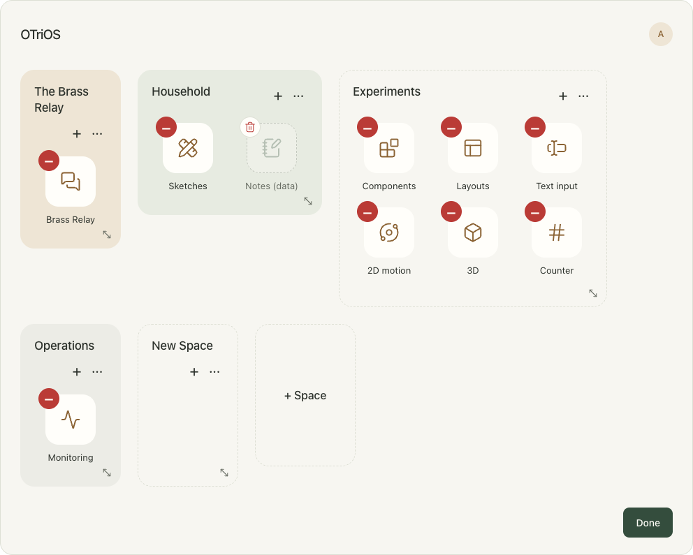
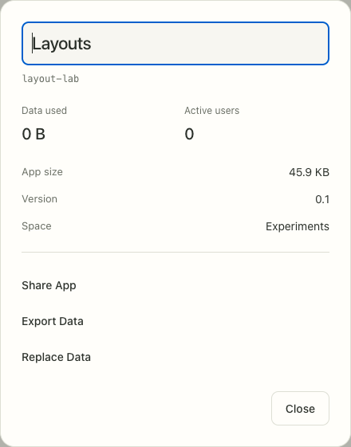
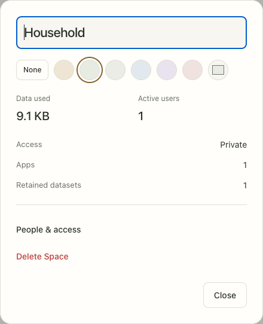
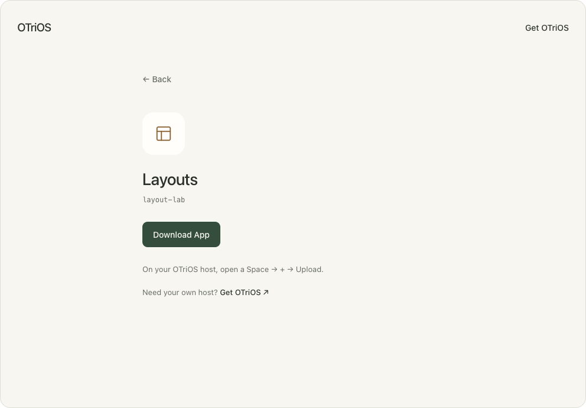

<!-- SPDX-License-Identifier: Apache-2.0 -->
# RFC 0028: Spaces map, app sharing and portable data

Date: 2026-11-01; delivery plan revised 2026-11-02. Status: **combined implementation
deployed; final Safari acceptance pending**.

Map/settings, retained data, scoped moves, signed app sharing/import and portable
data export/replacement are implemented in the single M2 delivery. The active
Frame/Web release uses state v20, Spaces envelope v5 and registry OTSP9 while
preserving opening release-control v1. See the continuing
[combined qualification record](../experiments/spaces-portable-transfers-2026-11-02.md)
for exact signed hashes, full local/process checks, real browser and calibrated
Frame transfers, live migration, compatible rollback and preservation evidence.
Safari acceptance remains outstanding, so this RFC is not marked complete and
no final review PR has been opened.

Aaron authorized completion on 2026-11-01 and consolidated the former M2–M4
into one delivery step on 2026-11-02. The earlier
[M1](../experiments/spaces-map-frame-2026-11-01.md),
[retained-data](../experiments/spaces-retained-data-2026-11-01.md) and
[admin/moves](../experiments/spaces-admin-and-moves-2026-11-01.md) records remain
historical baseline evidence. The browser concept remains illustrative; deployed
operations and qualification results establish behavior.

Builds on [Spaces and app data](0027-spaces-and-app-data.md),
[signed app bundles](0025-standalone-app-bundles.md),
[editable layout](0015-editable-home-reflow.md) and the
[shared session](0009-unified-server-session.md).
The [Spaces guide](../SPACES.md) remains the operational contract for RFC 0027.

## Purpose

Give visitors, friends and administrators one recognizable entrance. Do not ask
people to choose a persona, or infer their intention from their permissions.
People see the Spaces they can access, open an app, and return to the same map.
Administration becomes visible when an authorized person chooses Edit.

The default surface contains the OTriOS identity, sign-in or a profile avatar in
the upper-right corner, and the Spaces map. Omit the “Spaces” heading, welcome
copy, role labels, storage statistics and explanatory subtitles from the map.
The Admin's Edit action sits in the lower-right corner; Done occupies the same
position while editing. Keep it reachable without overlapping content.

Names, grouping, app icons and spacing establish hierarchy. Put information in
settings when someone asks for it. Show confirmation, permission, connectivity
and failure details when they affect the next action, rather than as permanent
decoration. Center each app name beneath its icon, including each line of a
wrapped name. Use the same artwork and label arrangement in Add App. Browser
and native Frame share these semantics.

## Common entrance and navigation

- An unidentified visitor sees accessible public Spaces only. Signing in adds
  admitted private Spaces without introducing a different dashboard.
- A sign-in initiated inside an app retains the destination and intended action.
  Authentication alone grants neither membership nor Admin rights.
- Selecting a Space with one attached app opens that app directly. Selecting a
  Space with several apps exposes its apps; individual app icons also launch
  directly from the map. Do not automatically leave the entrance merely because
  only one Space is visible.
- A launch still needs compatible verified code, current admission, a collection
  binding and a qualified first view. A failed launch keeps the last usable view.
- Outside Edit, hide Spaces with no attached apps. A Space containing only
  retained datasets is available to its Admin in Edit. An attached but unavailable
  app is not an empty Space: keep its entry and explain the launch problem on use.
- Outside Edit, hide retained-data tiles and editing affordances. Uninstalling
  local code remains distinct from detaching an app from a shared Space.
- Keep the active account visible through the profile control. A shared Frame's
  device identity must not be mistaken for the person touching it.

Empty filtering affects presentation only. It never deletes a Space, membership,
attachment or dataset. Discovery must not leak hidden Space names, membership,
layout gaps, retained data or usage metadata.

## Map layout and Edit mode

Each Space has a stable ID, display name, order, background and preferred size.
Width and height use app-cell units: Brass Relay can be one cell wide;
Experiments can be three by two. These are logical sizes, not physical pixels.
Reflow for portrait, landscape and narrow browsers while retaining order and
preferred sizes. Never clip apps to satisfy a requested size; grow to fit content.

Layout is shared presentation metadata owned by the authority. Edit mode,
selection, focus, drag previews and open dialogs stay local. An Admin may modify
only Spaces they administer. Reordering changes the moved Space's placement;
it must not require editing another Space's configuration. Relative order anchors
must be admitted visible Spaces, not client-supplied references to hidden records.
The authority may rebalance its internal order representation without exposing it.

Edit reveals:

- **+ Space**, creating a Closed Space with the creator as an Admin when host
  policy permits creation. An empty new Space remains visible until Done.
- A **+** in each editable Space for Add App.
- A Space's **title area**, draggable to reorder that Space. A tap opens its
  settings. Remove the separate reorder-handle control.
- A **corner handle** for resizing. Width/height form fields are unnecessary.
- Slightly jiggling app tiles that can be reordered. Respect reduced-motion
  preferences and provide an equivalent static editing cue.
- A red **−** on an attached app, opening its deletion dialog.
- Ghosted retained datasets after every attached app, with their own data-delete
  control. Their labels end in **(data)**, for example **Notes (data)**.

Keep pointer, touch and keyboard interaction equivalent. Arrow keys can reorder
a focused tile or Space title and resize a focused corner. Keyboard pickup,
destination selection and drop must support cross-Space movement without adding
a redundant Move menu. Dragging must not accidentally launch an app or open a
settings panel. Cancelled gestures leave authoritative layout unchanged.

Conflicting edits use expected metadata generations. Do not overwrite another
Admin's newer name, color or placement with a stale whole-map snapshot. Reconcile
on conflict. Unknown outcomes refresh state instead of replaying management
commands. Keep management on the existing negotiated session and preserve its
bounded discovery/resync behavior.



## Settings

### App settings

Place an editable display-name field at the top, with the immutable **bundle ID**
immediately underneath. Renaming changes this Space's label, not signed bundle
metadata, bundle identity, another Space's label or the data binding. There is no
Rename button. Persist name edits through the authority with confirmation/error
feedback as needed; the concept's local updates are not evidence of persistence.
Display-name edits also preserve app routes and immutable share URLs.

Show data used, active users, app size, version/revision and the current Space.
Keep three actions for an attached app:

- **Share App**: share the immutable app bundle, excluding mutable data.
- **Export Data**: download a portable confirmed snapshot of this dataset.
- **Replace Data**: choose a compatible data payload and review replacement.

Omit Move and Delete App from this panel. Drag/drop and the tile's red minus
already provide those actions. A retained-data tile opens its dataset information,
with Restore App, Export Data and Replace Data; it has no runnable app to share.
Its tile's delete control removes data explicitly.

Bundle IDs and basic code identity follow admitted metadata. Retained collections,
bulk data management and administrative usage information remain Admin-only.
Do not expose them merely because public app content is readable.



### Space settings

Use one panel for its editable name, background palette **directly beneath the
name**, usage and access information. Include **None**, meaning no background
fill while retaining the grouping. Colors must remain legible in both themes.
Remove the separate appearance panel and width/height fields. The title and
ellipsis enter this same settings panel in Edit.

Show data used, active users, attached apps, retained datasets when present, and
the audience setting. People & access contains Member/Admin management and the
Closed/Public view/Public view and comment choices from RFC 0027. New Spaces
remain Closed; signed-in visitors comment only where explicitly permitted.
Keep last-Admin protection and rejection of public audiences for closed-only apps.

Delete Space is a scoped action in settings, not a permanent map control.
Deleting without Remove Data retains a recoverable Space record, its membership
configuration and data; restoration requires a current authorized administrator.
Deleting with Remove Data also initiates its whole-dataset deletion lifecycle.
Revalidate authorization when restoring; saved membership is not a credential.



### Meaning of usage information

Data used covers reachable authoritative checkpoints, journals, materialized
presentations and owned assets for the selected dataset or Space, including
retained datasets. Deduplicate shared blobs within that total; it need not equal
physical disk consumption. App size is
the verified bundle's logical file bytes, not a transient compressed download.
Unknown measurements display unknown, not zero.

Active users means participants with an accepted, currently admitted mount.
Deduplicate authenticated principals across their connections; count anonymous
connections as separate ephemeral participants. This is not a census of people
or durable presence history. Do not expose participant identities with the count.
All usage numbers in the concept images are fixtures, not live measurements.

## App removal, retained data and replacement

The **Delete App** modal identifies the selected app, has **Cancel** and **Delete**,
and an unchecked **Remove Data** option. Delete affects this Space's attachment,
not installation on every device or other Spaces.

| Choice | Outcome |
| --- | --- |
| Remove Data unchecked | Detach, stop the affected sessions/services, retain the collection and show its ghost in Edit |
| Remove Data checked | Detach and request permanent deletion of this collection |
| Delete a ghost's data | Confirm whole-dataset deletion; remove that retained dataset |
| Restore App from a ghost | Reattach compatible available code to that dataset; preserve confirmed content |
| Replace Data | Validate the incoming snapshot, retain the outgoing dataset as a sealed backup, then activate a fresh collection identity |

App removal followed by ordinary reattachment retains RFC 0027's collection
identity. Replacement, cross-Space transfer and backup restoration must acquire
fresh admitted bindings so old writers cannot resume against the new content.
Code rollback must never roll data back.

Retained datasets and replacement backups are distinct from additional active
app instances. Extend RFC 0027's management model to permit several **inactive**
datasets for a bundle in one Space, while keeping **one active attachment per
(Space ID, bundle ID)**. Every retained dataset has a stable management ID, schema
identity and explicit provenance. Backups use distinguishable names, such as
“Notes before replacement (data)”, without changing their bundle association.

Keep a preferred retained dataset for ordinary reattachment; never silently pick
an arbitrary backup. A ghost's Restore action selects that exact dataset. If
the app is already attached, restoration uses the same replacement review and
backs up its current data instead of creating a second active app.

Permanent deletion inherits RFC 0027's durable decision, producer shutdown,
revocation, stale-writer rejection, deletion records and reference-counted blob
reclamation. A removed tile is not proof that bytes have been physically erased.
Report pending cleanup when necessary. Managed backup retention and independently
exported or operational copies remain separate; do not promise their immediate
erasure. Never restore an older backup in a way that resurrects a deleted binding.

## Dragging apps and data across Spaces

Moving requires Admin authority in both source and destination. It is a bounded
operation within one authority, not federation or a general transaction API.
Reorder within a Space immediately through the layout command. A cross-Space
drop opens a review naming both Spaces and the destination audience.

For an attached app offer:

| Selection | Source | Destination |
| --- | --- | --- |
| App and data | Remove attachment and transferred dataset | Attach app with the transferred content |
| App only | Remove attachment; retain its dataset as a ghost | Attach compatible code, without copying source data |
| Data only | Keep attachment with a fresh empty collection | Receive the transferred dataset |

A ghost moves data only. A destination without an attachment receives a ghost;
it does not automatically execute code. Moving data into a public Space is an
explicit publication of that data and its required owned assets. Closed-only
apps/datasets cannot be moved into an incompatible audience. Do not leave private
asset references that grant access back into the source Space.

An occupied destination is never an implicit merge or a second active instance.
For App only, retain its existing compatible attachment/data, and say so in the
review. For a data-bearing move, reuse the destination's app slot, retain its
outgoing data as a sealed backup and use the replacement review. Incompatible
schemas or unavailable host services reject the move before either side changes.
Service credentials and collector grants do not move with a dataset. A service
requiring a new destination binding needs an independently authorized plan.

Quiesce the affected producers, finish confirmed writes and active gestures, and
stage a complete snapshot. Revalidate both permissions and source/destination
binding generations at commit. Activate destination data with a fresh collection
identity; retire the old source binding and reject delayed source writes. Empty
source replacement collections also receive fresh identities. Transfer asset
ownership/references with the data, not mutable links into the former Space.

Journal this scoped management transition before acknowledgement. Recovery must
finish or roll back its recorded binding decision without exposing an intermediate
partially moved state. Preserve every confirmed edit and required backup; never
resolve recovery by accepting both writable copies or dropping one silently.
Refresh an uncertain outcome by operation ID; do not blindly repeat the move.

## Add App and sharing

Add App keeps the available-app choices and adds an **Upload** tile. Its drop
target accepts an app payload file or a shared app URL. Upload also offers Choose
File and a URL field, so drag/drop is not required. Receiving bytes or a URL stages
a candidate; it does not immediately execute, trust, attach or publish it.
Offer file selection only on hosts with a qualified picker; the Frame can use the
shared URL path with its existing text input. Do not imply native file picking
already exists or require general filesystem capabilities inside app code.

Attach an already verified installed bundle using the Space's management rights.
Installing new code additionally needs the host's installation authorization and
publisher policy. Space Admin does not imply infrastructure operator. The UI may
combine the authorized steps, but the authority must keep their checks separate.

Share App explicitly publishes **code only** through host policy. Space Admin
alone cannot bypass protection of private bundle bytes. A public share is a
separate, immutable delivery object, not a public alias for the private bundle
directory or an authenticated mount. State that anyone with the link can download
the app and that data is excluded. Do not change audience or attach the app to
another Space as a side effect.

The public page uses the bundle's canonical name and ID, not a private Space label.
Show Download App, brief import instructions and Get OTriOS linking to the project
source and hosting guide. Do not require an OTriOS account to download a published
bundle. No store, ratings, account connection or custom URL scheme is required.



## Minimum transfer contract

The [versioned payload contract](../TRANSFERS.md) pins container/media types,
budgets and the metadata boundary. Its reserved checkpoint identifiers require
exact codec layouts and conformance vectors before deployment.

### Immutable app URL and payload

```text
GET https://HOST/apps/BUNDLE_ID/BUNDLE_SHA256
    -> public HTML download page, only for an explicitly published share
GET https://HOST/apps/BUNDLE_ID/BUNDLE_SHA256/download
    -> attachment: BUNDLE_ID.otapp.zip
```

The same HTTPS page URL is pasteable/droppable into Upload on another host. The
receiver resolves its download endpoint directly; it does not scrape arbitrary
HTML or require browser auto-installation. A plain download is not an install.
Unpublished bundles return no public code or protected metadata through this path.

The ZIP contains RFC 0025's flat `.otapp` tree, without an extra wrapper folder:
Info.flex, UI, schemas, optional code/resources/dependencies, integrity manifest,
publisher receipt and distribution notices. Exclude mutable data, credentials,
Space records, grants, host executables and compilation caches. Archive timestamps,
file order and compression do not change the existing bundle digest.

BUNDLE_SHA256 is RFC 0025's existing domain-separated digest of the exact integrity
manifest bytes. Verify the complete file closure, the digest named by the URL,
publisher signature against independently configured trust, required features,
dependencies and existing package limits. A hash or a source URL does not establish
publisher trust or grant access. No automatic trust-root enrollment is added.
Preserve original signed bytes when importing and use the established signed
installation/activation workflow on the receiving host.

Same ID and digest can reuse installed code. A different digest for an installed
ID is an update candidate, not a silent update of every Space. It requires an
explicit authorized version-change plan under RFC 0025. Incompatible candidates
leave installed code, attachments and data unchanged. Privileged services are
not installed merely because their UI bundle was shared.

Archive decoding must add hostile-input protection beyond RFC 0025's quiescent
tree reader: bounded compressed/expanded sizes, entry counts and path depth;
matching local/central ZIP records; no encrypted entries, traversal, duplicate or
case-alias paths, links, special files or unlisted bytes. Accept stored/Deflate
regular files only, with implicit directories. Stream into isolated staging and
verify before publication; never extract over an active bundle or state directory.
Receiver URL fetching follows host network policy, has bounded time/bytes and
redirects, and never forwards source-site cookies or host credentials.

Publishing does not make copies revocable. Removing an app, changing membership
or deleting its Space does not erase an independently published/downloaded bundle.
Withdrawal can stop future delivery of that share without promising recall.

### Portable data payload

Use a distinct `.otdata` ZIP container with a versioned portable checkpoint:

```text
Info.flex                  # otrios-app-data-v1 metadata
State/checkpoint.bin        # checkpoint in its declared, versioned codec
Assets/SHA256              # required owned asset bytes, when present
Integrity/files.flex       # sorted exact-byte file sizes and SHA-256 digests
```

Required metadata identifies the format, bundle ID, exact schema SHA-256, state
codec/version and checkpoint path. The checkpoint contains the app-owned roots
and collection structure needed for a coherent export, including necessary causal
metadata, but not source session grants, writer receipts or authority credentials.
Collection IDs from another host are not import authority. Owned assets must be
complete and hash-verified; ordinary user links do not become access grants.

The integrity manifest covers every regular file except itself, with canonical
path sorting and a separately versioned data-manifest format. Hash exact bytes;
never normalize signed/code metadata or use a data hash as authentication. No app
executable or host configuration is imported from a data payload.

Export pins a coherent **confirmed** checkpoint and its asset closure while other
work continues or through a scoped write barrier where needed. It excludes
unconfirmed client RAM drafts and supplies no durable offline-client feature.
An app without a qualified portable codec reports export/replacement unavailable;
do not mislabel a private state-directory tarball as portable data.

Replace Data requires Admin authority, matching bundle/schema/codec support,
complete validation and a review naming the destination and its audience. Stage
off to the side; retain the current dataset as a sealed backup; activate a fresh
collection identity only after the durable binding decision. Revalidate generation
and authorization after any upload delay. Invalidate former mounts and stale
writer contexts. A failure or unknown outcome must not partially overwrite data
or automatically repeat replacement. Restoring a backup follows the same path.

Before the combined milestone ships, pin the exact FlexBuffers field types,
magic/version prefixes, canonical manifest encoding, archive and checkpoint
budgets, codec conformance vectors and media types in a versioned public contract.
This RFC defines the minimum semantics and file/URL shape, not an implemented or
already stabilized wire format. Current runtime limits must not be relaxed merely
because an archive can contain a larger file.

## Admin UI completion and execution order

The 2026-11-01 plan adjustment prioritizes completing the unified admin UI before
the next deployment. The visual and interaction reference is the
[approved interactive prototype](../experiments/data/spaces-map-2026-11-01/admin-ui-reference.html),
snapshotted from `target/design-exploration/otrios-spaces-map-settings.html` and
reviewed in Safari. Its SHA-256 is `9ffabba5c5704f8d9817923aad35abc7cf8f352a83b9f02c6b7927e45864adf5`.
This prototype is a design fixture; its simulated counts, transfer previews and
local mutations are not implementation or acceptance evidence. Later user
instructions remain authoritative, including no visible Saved success message.

The user also authorized resetting app/Space data where useful for this rollout.
That authorization does not relax the product's confirmed-data invariants or its
move/replacement/crash-recovery acceptance requirements.

Complete this refinement of M1/M2 while finishing M3, then implement M4:

1. **Shared panel presentation.** Keep the Spaces map visible beneath one dimmed,
   rounded settings/dialog surface. Use consistent spacing, editable headings,
   paired usage statistics, information rows, separators and action placement.
   Focus stays inside the panel; closing/Escape restores the initiating control.
   Short and narrow viewports scroll panel content without obscuring actions.
   Native Frame and Web share the same authored controls and hit geometry.
2. **Space and access.** Implicit name editing and the palette (including None)
   lead the Space panel. Follow with data used, active users, access, app count
   and retained-dataset count where present. Keep People & access and Delete
   Space as the essential actions. Consolidate audience choice, member roles,
   addition and removal into People & access; retain explicit access-change
   review, current-role checks and last-Admin protection. Remove the old
   Apps & Data/Sharing/Members/Cleanup navigation from the primary Space panel;
   expose necessary recovery/deletion facts in the relevant data/review panels.
3. **App, dataset and profile.** Use the same information pattern for active apps
   and exact retained datasets: editable local name, immutable bundle ID,
   statistics and current Space. Active apps include verified app size and
   revision with Share App, Export Data and Replace Data. Dataset information
   includes Restore App, Export Data and Replace Data. Keep deletion on tile
   minus controls. Put profile editing, Deleted Spaces and Sign out together;
   recover archived Spaces from Deleted Spaces. Display-name changes must not
   rename authenticated principals. Unknown measurements remain unknown.
4. **Moves in this UI.** Preserve the completed scoped-move backend and its data
   invariants. Use the shared review for pointer/touch drops and keyboard
   pickup, destination selection, drop and Escape cancellation. Name both
   Spaces, expose destination access, preserve occupied-destination backups,
   and require explicit public-data publication. No Move action is added to
   app settings. Keep success quiet and stale reviews non-destructive.
5. **Transfers in this UI.** Finish M4's real Share App/download page, Upload by
   payload or shared URL, Export Data and reviewed Replace Data inside these
   same panels. Preserve confirmed content and owned assets; retain outgoing
   data before replacement. Prototype preview messages do not satisfy M4.

Use a small critical-path UI set: panel opening/closing and focus, one access
review, exact retained-data actions, one move review, and transfer round trips.
Update or remove superseded management-page assertions. Keep storage/crash/race
coverage for the underlying data invariants. Qualify the populated Web map in
Safari and the physical Frame, then deploy through the existing signed-release
and verified-host workflow. Record actual acceptance, commit/push completed
changes, and create the final PR only after the full scope is ready for review.

## Implementation and acceptance

Map, retained-data and scoped-move deployments are the current baseline.
Complete and qualify RFC 0028 together as one **M2: Retained
data and transfers** delivery. The former M2, M3 and M4 are work areas within
this milestone, without separate qualification, deployment or approval gates.
The concept screens are fixtures, not acceptance evidence. Runtime transitions,
validation and their tests belong in LGPL `otrios-core`; public contracts,
schemas, docs and thin tools remain Apache.
Do not copy runtime implementation into the permissive app/tool packages.

| Milestone | Scope and required evidence |
| --- | --- |
| M1: Map and settings | Filtered common entry; destination-preserving sign-in; single-app launch; Admin-only Edit; shared name/color/order/size; title drag and corner resizing; no empty Spaces outside Edit; implicit labels with stable bundle IDs; native/browser parity and keyboard/reduced-motion checks |
| M2: Retained data and transfers | Retained datasets and backups; scoped app/data moves; signed app sharing/import; portable data export/replacement; the integrated acceptance coverage below |

Build shared mechanisms once: a versioned dataset registry and binding lifecycle,
coherent snapshot/asset staging, backup replacement, durable management decisions
and recovery. Reuse them for restore, move and import instead of introducing
temporary implementations between those features. Pin the public transfer
contracts early, then connect authority operations and native/browser controls
to the same implementation. Internal commits may follow dependency order without
requiring an intermediate release.

Use one acceptance matrix and qualification record for the combined scope:

| Work area | Required evidence |
| --- | --- |
| Retained data | Exact ghost identity/order; unchecked/checked Remove Data; restore and backup replacement; no duplicate active instances; existing deletion/revocation rules; truthful usage and unavailable-codec states |
| Scoped moves | Every app/data combination; occupied destinations; public exposure review; incompatible/private-only rejection; separate process write/revocation races; crash recovery; stale receipts cannot recreate source data; no shared-blob loss |
| Transfer contracts | Pinned codec/bounds/fixtures; archive round trips and malformed-input rejection; signed cross-host app import without auto-trust; ordinary-browser page; upload by file/URL; complete confirmed data/assets export; replacement with backup and fresh bindings; failed imports preserve all existing content |

Exercise common replacement, revocation and recovery invariants in shared tests,
with operation-specific cases for restore, move and import. Reuse that evidence
across work areas; retain distinct authorization, failure and process-boundary
cases where behavior differs. During development run checks affected by each
change. Run the complete `bash scripts/check.sh` and scoped integration suite on
the final candidate, then perform one signed-release qualification campaign with
real browser/physical Frame acceptance, migration and rollback verification.
Repeat checks when subsequent changes invalidate their evidence; completing a
work area alone does not require repeating the full campaign.

Preserve the v1 opening release-control envelope and event-driven upgrade discovery.
Version changed management formats and bump the declared state protocol whenever
its bytes change; browser and native identifiers must agree. No additional shared
session connection is introduced. Connected handoffs wait for confirmed writes
and finished gestures; existing disconnected unconfirmed-RAM policy remains.

Version persisted layout/registry extensions as well. Migration preserves existing
Space, attachment and collection identities until an explicitly reviewed operation
changes a binding. Older writers that cannot preserve retained backups or durable
move/replacement decisions must reject the new format. Roll back only to compatible
code; never substitute an old registry or state snapshot for current confirmed data.

The combined delivery follows the existing verified signed-release, migration and
rollback workflow, with confirmed-data inventories before and after acceptance.
Do not claim Linux shared-memory IPC acceptance from these UI/process checks.

Keep unavailable actions truthful until the combined milestone qualifies; the
current deployed release remains the baseline while development proceeds. This delivery-plan
revision itself requires no deployment, data migration, new publisher trust,
public share or change to the existing Frame's confirmed data.
